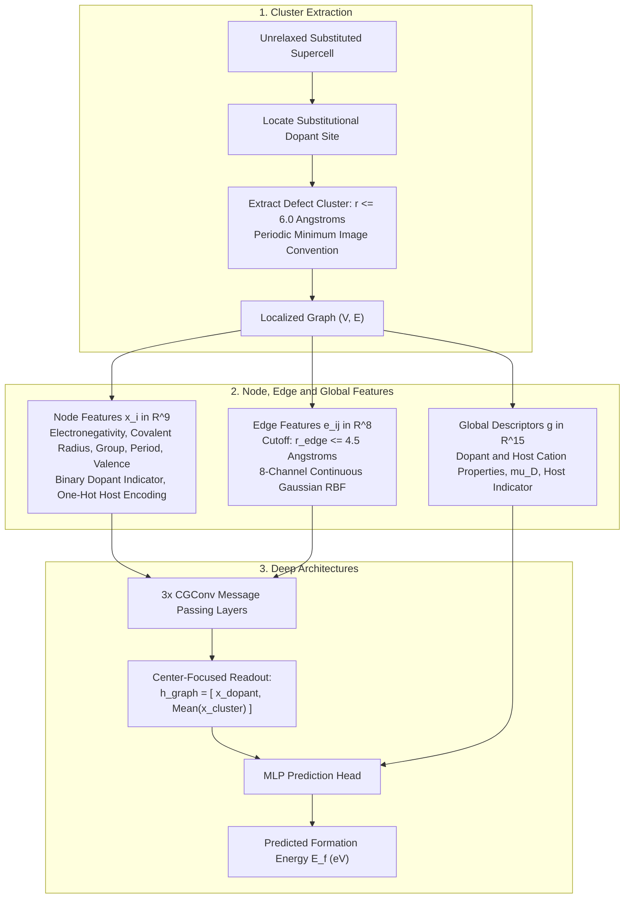

# MLIP-guided Graph Neural Network for dopant formation energies

[](https://www.python.org/downloads/release/python-3100/)
[](LICENSE)
[](https://pytorch-geometric.readthedocs.io/)
[](https://chgnet.lbl.gov/)

A machine learning framework and surrogate benchmark for predicting neutral substitutional defect formation energies in wide-bandgap semiconductors (4H-SiC and wurtzite GaN). The pipeline couples a machine-learned interatomic potential (CHGNet) for ionic relaxation with Crystal Graph Convolutional Neural Networks (DefectGNN) evaluated directly on unrelaxed defect-centered cluster graphs. The framework investigates graph neural network generalization, failure modes of discrete element embeddings in small-data regimes, diagnostic feature ablations, Leave-One-Dopant-Out cross-validation, and closed-loop active learning workflows.

---

## 1. Materials Science and Defect Thermodynamics Theory

### 1.1 Wide-Bandgap Semiconductors and Point Defect Engineering
Silicon carbide (4H-SiC, Materials Project mp-11714) and wurtzite gallium nitride (GaN, Materials Project mp-804) are wide-bandgap semiconductors ($E_{\mathrm{g}} \approx 3.23\text{ eV}$ for 4H-SiC, $3.44\text{ eV}$ for GaN) with high critical electric breakdown fields ($> 2.5\text{ MV/cm}$) and high thermal conductivity. Incorporating substitutional transition-metal and main-group dopants introduces localized electronic states in the bandgap that serve as recombination centers, luminescence emitters, or spin qubits.

Both crystals share the hexagonal space group $P6_3mc$ (No. 186), but differ in stacking sequence and cation site multiplicity:
- **4H-SiC**: Four-bilayer stacking along the $c$-axis creates two symmetry-inequivalent silicon sites:
  - Quasi-hexagonal site ($h$): Wyckoff position $2b$, internal site index 0.
  - Quasi-cubic site ($k$): Wyckoff position $2a$, internal site index 1.
- **Wurtzite GaN**: Two-bilayer stacking contains only one symmetry-inequivalent gallium site:
  - Wyckoff position $2b$, internal site index 0.

Because the local coordination polyhedra and crystal fields differ between $2b$ and $2a$ sites in 4H-SiC, dopant substitution produces distinct formation energies at each position. Symmetrized sites are identified using `SpacegroupAnalyzer` and mapped to supercell coordinates by Cartesian position.

### 1.2 Neutral Substitutional Formation Energy Formalism
For a neutral defect where a host cation $X$ ($X = \text{Si}$ or $\text{Ga}$) is replaced by dopant $D$ ($D_X^0$ in Kroger-Vink notation), the formation energy is:

$$
E_{\mathrm{f}}[D_X^0] = E_{\mathrm{doped}} - E_{\mathrm{host, supercell}} + \mu_X - \mu_D
$$

where:
- $E_{\mathrm{doped}}$ is the total energy of the relaxed 3x3x3 supercell containing the single substitutional dopant (eV).
- $E_{\mathrm{host, supercell}}$ is the total energy of the relaxed defect-free host supercell (216 atoms for 4H-SiC, 108 atoms for GaN) under identical conditions (eV).
- $\mu_X$ is the host cation chemical potential (eV/atom).
- $\mu_D$ is the dopant chemical potential (eV/atom).

#### Chemical Potential Boundaries (Cation-Rich Limit)
Chemical potentials are bounded by elemental and compound thermodynamic equilibria to prevent bulk phase precipitation:
- **4H-SiC**: Under $\mu_{\mathrm{Si}} + \mu_{\mathrm{C}} = \mu_{\mathrm{SiC(bulk)}}$, the cation-rich (Si-rich) limit fixes $\mu_{\mathrm{Si}} = \mu_{\mathrm{Si(bulk)}}$ (diamond cubic Si, mp-149) and $\mu_{\mathrm{C}} = \mu_{\mathrm{SiC(bulk)}} - \mu_{\mathrm{Si(bulk)}}$.
- **GaN**: Under $\mu_{\mathrm{Ga}} + \mu_{\mathrm{N}} = \mu_{\mathrm{GaN(bulk)}}$, the cation-rich (Ga-rich) limit fixes $\mu_{\mathrm{Ga}} = \mu_{\mathrm{Ga(bulk)}}$ (orthorhombic Ga, mp-142) and $\mu_{\mathrm{N}} = \mu_{\mathrm{GaN(bulk)}} - \mu_{\mathrm{Ga(bulk)}}$.
- **Dopant**: The upper solubility limit before dopant segregation is set by its bulk elemental ground state: $\mu_D = \mu_{D\mathrm{(bulk)}}$.

#### Computational Relaxation Protocol
Atomistic relaxations are carried out with CHGNet (Crystal Hamiltonian Graph Neural Network):
1. **Neutral charge state ($q = 0$)**: Avoids long-range periodic Coulomb image corrections.
2. **Fixed-cell relaxation**: Supercell lattice vectors remain clamped to the pristine relaxed host dimensions, relaxing only ionic positions until maximum interatomic forces fall below $0.05\text{ eV/\AA}$. This captures local bond relaxation around the defect without artificial cell distortion.

---

## 2. Machine Learning Surrogate Theory and Graph Architecture

### 2.1 Screening Surrogates on Unrelaxed Geometries
Evaluating point defect formation energies via atomistic potentials requires minutes per structure for 216-atom supercells. The surrogate model is formulated to predict relaxed formation energies $E_{\mathrm{f}}$ directly from unrelaxed substituted geometries in milliseconds, allowing rapid prioritization before running full relaxations.



### 2.2 Local Cluster Graphs and Feature Engineering
Because defect strain drops rapidly with distance, whole-cell supercell graphs dilute the defect signal across hundreds of spectator atoms. A defect-centered cluster is extracted:
1. **Cluster radius**: Atoms within $r_{\mathrm{cluster}} = 6.0\text{ \AA}$ of the dopant site under periodic boundary conditions are retained.
2. **Edge radius**: Edges connect atom pairs within $r_{\mathrm{edge}} = 4.5\text{ \AA}$.
3. **Radial Basis Function (RBF) edges**: Interatomic distances $d_{ij}$ are expanded on an 8-channel Gaussian basis:

$$
e_{ij, k} = \exp\left( -\gamma (d_{ij} - \mu_k)^2 \right), \quad k \in \{1, \dots, 8\}
$$

with centers $\mu_k$ spaced uniformly from $0.5\text{ \AA}$ to $4.5\text{ \AA}$ and $\gamma = 1 / (2 \sigma^2)$.

4. **Node features ($\mathbf{x}_i \in \mathbb{R}^9$)**: Scaled Pauling electronegativity ($\chi / 4.0$), covalent radius ($r_{\mathrm{cov}} / 2.5\text{ \AA}$), periodic group ($G / 18.0$), period ($P / 7.0$), valence electrons ($V / 14.0$), binary dopant indicator ($I_{\mathrm{dopant}} \in \{0, 1\}$), and one-hot host indicator ($[1, 0]$ for SiC, $[0, 1]$ for GaN).
5. **Global descriptors ($\mathbf{g} \in \mathbb{R}^{15}$)**: For models incorporating global chemistry, $\mathbf{g}$ combines elemental descriptors of the dopant and replaced host cation, their differences ($\Delta \chi$, $\Delta r_{\mathrm{cov}}$), the dopant chemical potential $\mu_D$, and the host indicator.

### 2.3 Message Passing and Center Readout
Message passing uses Crystal Graph Convolution (CGConv) layers operating with continuous edge vectors:

$$
\mathbf{z}_{ij} = \left[ \mathbf{x}_i^{(l)}, \, \mathbf{x}_j^{(l)}, \, \mathbf{e}_{ij} \right]
$$

$$
\mathbf{x}_i^{(l+1)} = \mathbf{x}_i^{(l)} + \sum_{j \in \mathcal{N}(i)} \sigma\left( \mathbf{W}_{\text{f}} \, \mathbf{z}_{ij} + \mathbf{b}_{\text{f}} \right) \odot g\left( \mathbf{W}_{\text{s}} \, \mathbf{z}_{ij} + \mathbf{b}_{\text{s}} \right)
$$

where $\sigma$ is the sigmoid gate, $g$ is Softplus, and $\mathbf{W}_{\text{f}}, \mathbf{W}_{\text{s}}$ are learnable weight matrices. 

The center-focused readout concatenates the final central dopant node representation with the mean cluster representation:

$$
\mathbf{h}_{\mathrm{graph}} = \left[ \mathbf{x}_{\mathrm{dopant}}^{(L)}, \, \frac{1}{|\mathcal{V}|} \sum_{i \in \mathcal{V}} \mathbf{x}_i^{(L)} \right]
$$

Predictions are generated via a 2-layer MLP with GELU activations. Targets are standardized strictly inside training folds ($y_{\mathrm{norm}} = (y - \bar{y}_{\mathrm{train}}) / \sigma_{y, \mathrm{train}}$) and trained using Smooth L1 loss with the AdamW optimizer and Cosine Annealing learning rate schedule.

---

## 3. Data Schema, Manifest Tracking, and Provenance

### 3.1 Data Schema
Defect configurations, status flags, and paths are tracked in [data/manifest.csv](data/manifest.csv):

| Column | Type | Description |
| :--- | :---: | :--- |
| `filename` | string | Unique primary key identifier (e.g. `SiC_doped_Ti_2b_0.cif`) |
| `host` | string | Host crystal system (`SiC`, `GaN`) |
| `site` | string | Symmetry-inequivalent site label (`2b_0`, `2a_1`) |
| `wyckoff` | string | Wyckoff letter (`2b`, `2a`) |
| `dopant` | string | Dopant chemical symbol (e.g. `Ti`, `Fe`, `U`) |
| `dopant_z` | integer | Dopant atomic number |
| `status` | string | Pipeline lifecycle state (`unrelaxed`, `relaxed`, `candidate`) |
| `ood_flag` | boolean | Out-of-distribution indicator (True for Uranium) |
| `unrelaxed_path` | string | Relative path to unrelaxed CIF |
| `relaxed_path` | string | Relative path to CHGNet relaxed CIF |

The dataset spans 33 dopants: 25 transition metals (3d, 4d, 5d), 7 main-group elements (Al, Ca, Ge, Mg, Sn, Be, Cd), and 1 actinide (U) across 4H-SiC ($2b_0$, $2a_1$) and GaN ($2b_0$), totaling 99 training/evaluation defect structures and 2 candidate configurations.

### 3.2 Archival and Provenance
Earlier pipeline revisions had two known issues:
1. `generate_defects.py` mapped unit-cell site indices onto supercells by index rather than Cartesian position, duplicating the $2b$ site twice.
2. Legacy CSV files retained unrelaxed energy labels from early prototypes.

All duplicate-site structures and legacy rows were safely isolated into [archive/legacy_v1/](archive/legacy_v1) and [archive/legacy_v0/](archive/legacy_v0) with cryptographic MD5 verification preserved in [archive/legacy_v0/NOTES.md](archive/legacy_v0/NOTES.md).

---

## 4. Evaluation Protocol and Model Hierarchy

### 4.1 Leave-One-Dopant-Out (LODO) Cross-Validation
Random train-test splits allow chemical data leakage: if Titanium on 4H-SiC $2b_0$ is in the training set, a model memorizes Titanium properties when predicting on $2a_1$ or GaN. Under LODO:
- All defect structures containing a specific dopant element $D$ across both hosts and all Wyckoff sites are held out together.
- Models are trained on the remaining 32 dopants and evaluated strictly on the unseen element.
- Test predictions are pooled across all 33 folds to compute unbiased MAE, RMSE, and $R^2$.

### 4.2 Leave-One-Host-Out (LOHO) Cross-Validation
Cross-system transferability is tested by training exclusively on 4H-SiC (66 structures) and evaluating on GaN (33 structures), and vice versa. Because only two host crystals are present, this benchmark is exploratory.

### 4.3 Model Hierarchy and Architectural Variants
The benchmark evaluates multiple GNN configurations alongside classical reference baselines:

#### Graph Neural Network Architectures (Primary Focus)
1. **DefectGNN (Default)**: 3-layer CGConv operating on localized 6.0 Å defect clusters with 8-channel Gaussian RBF edges, 64-dim learned element embeddings, and center-focused readout.
2. **DefectGNN + Descriptors (`defect_gnn_desc`)**: Removes the discrete embedding table, passing continuous physical node attributes into the CGConv layers and concatenating the 15-dim global chemical descriptor vector $\mathbf{g}$ (including $\mu_D$) into the center readout.
3. **Residual GNN (`residual_gnn`)**: A hybrid model that couples a baseline prior with a dedicated CGConv head trained on the atomic cluster residuals.
4. **Legacy Isotropic GCN**: 2-layer Graph Convolutional Network on whole-cell graphs with unit edge weights (representing the initial v0 baseline).

#### Reference Baselines (Non-Graph)
5. **Mean Predictor**: Constant empirical training fold mean $\bar{y}_{\mathrm{train}}$ (zero-information baseline).
6. **Ridge Baseline**: Linear ridge regression ($L_2 = 1.0$) on 5 elemental descriptors (electronegativity, radius, group, period, valence) plus host one-hot encoding.
7. **Ridge Rich**: Linear ridge regression on 14 elemental and thermodynamic descriptors including $\mu_D$.
8. **GP Isotropic**: Gaussian Process with isotropic Matern 5/2 kernel on 14 descriptors.
9. **GP ARD**: Gaussian Process with Automatic Relevance Determination (Matern 5/2 kernel with independent per-feature length scales).

---

## 5. Active Learning and Closed-Loop Screening

### 5.1 Deep Ensemble Epistemic Uncertainty Estimation
An ensemble of $M = 5$ models is trained using bootstrap sampling and independent parameter initializations. For candidate graph $\mathbf{x}$:

$$
\bar{y}(\mathbf{x}) = \frac{1}{M} \sum_{m=1}^M \hat{y}_m(\mathbf{x}), \quad \sigma_{\mathrm{ens}}(\mathbf{x}) = \sqrt{ \frac{1}{M - 1} \sum_{m=1}^M \left( \hat{y}_m(\mathbf{x}) - \bar{y}(\mathbf{x}) \right)^2 }
$$

Uncertainty standard deviations are rescaled to physical units of eV.

### 5.2 Simulated Pool Benchmark and Live Screening
The pool benchmark (`src.models.active_learning --benchmark`) initializes from a seed pool of 6 samples and acquires batches of 4 candidates over 5 steps from the pool, comparing greedy uncertainty sampling against random acquisition. Evaluation is performed on a held-out cluster of unseen dopants (24 structures). In the live loop ([autonomous_lab.py](autonomous_lab.py)), candidate structures with $\sigma_{\mathrm{ens}} > 0.25\text{ eV}$ trigger automated CHGNet relaxation before logging and model retraining.

---

## 6. Results

> **Data Integrity Notice.** All numbers below reflect the corrected dataset (99 defect structures across 33 dopants, 40 converged elemental references, and both SiC $2b_0$ and $2a_1$ sites verified distinct) executed on an Nvidia Tesla T4 GPU on Google Colab.

### 6.1 Leave-One-Dopant-Out (LODO) CV Benchmark
The table summarizes pooled out-of-fold test metrics across 99 structures (33 dopant folds):

| Architecture Family | Model | Input Features / Representations | Pooled MAE (eV) | Pooled RMSE (eV) | Pooled $R^2$ | Spearman Error Rank Corr |
| :--- | :--- | :--- | :---: | :---: | :---: | :---: |
| **GNN Architectures** | DefectGNN (Default) | CGConv + element embedding | 1.6504 | 2.1116 | -0.7827 | - |
| | DefectGNN + Descriptors | CGConv (no emb) + 15-d descriptor | 0.7558 | 0.9810 | 0.6153 | - |
| | Residual GNN | GP ARD base + GNN residual head | 0.7172 | 0.9650 | 0.6277 | 0.3998 |
| | Legacy Isotropic GCN | Whole-cell graph (unit edges) | 1.2676 | 1.6228 | -0.0528 | - |
| **Reference Baselines** | Mean Predictor | Training fold mean | 1.2655 | 1.6214 | -0.0510 | - |
| | Ridge Baseline | 5 atomic descriptors + host | 0.9384 | 1.2092 | 0.4155 | - |
| | Ridge Rich | 14 descriptors (incl. $\mu_D$) | 0.8849 | 1.1612 | 0.4609 | - |
| | GP Isotropic | 14 descriptors, single length scale | 0.7130 | 0.9669 | 0.6263 | 0.4266 |
| | GP ARD | 14 descriptors, per-feature length scales | 0.3310 | 0.5169 | 0.8932 | 0.1779 |

Parity curves for all models are saved in [results/parity_lodo.png](results/parity_lodo.png) and fold-by-fold metrics in [results/cv_metrics.csv](results/cv_metrics.csv).

### 6.2 Leave-One-Host-Out (LOHO) Exploratory Transfer Benchmark
Cross-system transferability between 4H-SiC and GaN:

| Architecture Family | Model | GaN Test (Trained on SiC) MAE (eV) | SiC Test (Trained on GaN) MAE (eV) | Pooled MAE (eV) | Pooled $R^2$ |
| :--- | :--- | :---: | :---: | :---: | :---: |
| **GNN Architectures** | DefectGNN (Default) | 1.6819 | 3.5514 | 2.9282 | -5.2251 |
| | DefectGNN + Descriptors | 54560.62 | 8844.06 | 24082.91 | -4.21e8 |
| | Residual GNN | 1.4604 | 1.0718 | 1.2013 | 0.1710 |
| | Legacy Isotropic GCN | 1.9214 | 0.9024 | 1.2421 | -0.0105 |
| **Reference Baselines** | Mean Predictor | 1.9197 | 0.9248 | 1.2564 | -0.0257 |
| | Ridge Baseline | 1.3799 | 1.1559 | 1.2305 | 0.0822 |
| | Ridge Rich | 1.4268 | 0.8855 | 1.0659 | 0.2824 |
| | GP Isotropic | 1.4233 | 0.8671 | 1.0525 | 0.3591 |
| | GP ARD | 1.6844 | 0.6290 | 0.9808 | 0.2732 |

Default DefectGNN achieves bounded error (1.6819 eV MAE) when transferring to GaN, demonstrating that structural message-passing filters transfer across hexagonal hosts. However, when trained on GaN (only 33 samples and 1 Wyckoff site), it lacks sufficient structural diversity to resolve the two distinct SiC sites, increasing error to 3.5514 eV. Meanwhile, DefectGNN + Descriptors explodes on cross-host transfer because unnormalized global chemical coordinates (such as host chemical potentials) shift outside the training distribution, causing unregularized neural readout layers to produce extreme extrapolations.

### 6.3 GNN Diagnostic Analysis: The Embedding Bottleneck and Resolution
Diagnostic experiments from [results/diagnostics.csv](results/diagnostics.csv) isolate the exact mechanisms behind GNN success and failure:

| Diagnostic Check | Architecture Variant | $N$ | MAE (eV) | RMSE (eV) | $R^2$ | Scientific Finding |
| :--- | :--- | :---: | :---: | :---: | :---: | :--- |
| **Embedding Coverage** | Default DefectGNN | 33 | - | - | - | In 33/33 LODO folds, the held-out element has an untrained embedding row |
| **Embedding Ablation** | Default (embedding, no descriptors) | 99 | 1.6504 | 2.1116 | -0.7827 | Embedding table outputs uninitialized random noise on unseen elements |
| **Embedding Ablation** | Continuous features only (no embedding) | 99 | 0.7102 | 0.9456 | 0.6425 | **Removing the discrete embedding drops MAE by 0.94 eV** |
| **Embedding Ablation** | Continuous features + $\mu_D$ in readout | 99 | 0.7676 | 0.9832 | 0.6135 | Stable, physically grounded generalization across all unseen elements |
| **Identity Ceiling** | Ridge on one-hot dopant+host+site (5-fold) | 99 | 0.8080 | 1.0742 | 0.5387 | Upper bound for pure identity memorization (random split) |

#### Analysis: Why the Default GNN Failed and How It Was Resolved
1. **The Discrete Embedding Failure Mode**: The default DefectGNN assigns each chemical element an index in a 64-dimensional learned embedding table. Under random splits, this allows the network to memorize element-specific corrections. Under LODO, however, the held-out dopant was never observed during training. Because the embedding table is randomly initialized, the network feeds unoptimized Gaussian noise into the message passing layers for the central defect node, producing an MAE of 1.6504 eV and negative $R^2$.
2. **The Continuous Feature Fix**: When the discrete embedding table is removed and replaced entirely with continuous physical node features (electronegativity, covalent radius, group, period, valence), the GNN's error drops by **0.94 eV** down to **0.7102 eV** ($R^2 = 0.6425$). This demonstrates that the Crystal Graph Convolution layers and defect-centered cluster representations are effective; the initial failure was strictly caused by the discrete lookup table bottleneck.
3. **Descriptor and Residual Augmentation**: Augmenting the readout with the 15-dimensional descriptor vector (`defect_gnn_desc`) stabilizes prediction to **0.7558 eV MAE**, while the hybrid Residual GNN (`residual_gnn`) reaches **0.7172 eV MAE** ($R^2 = 0.6277$), proving that GNN message-passing captures meaningful local steric and geometric strain on top of chemical baselines.

### 6.4 Scientific Findings: GNN Generalization vs Analytical Baselines
While architectural reformulations allow DefectGNN to generalize reliably (0.7102 to 0.7558 eV MAE), Gaussian process baselines (specifically GP ARD at 0.3310 eV MAE, $R^2 = 0.8932$) achieve lower error on this compact dataset.

The physical and statistical reasons are:
1. **Thermodynamic Formation Energy Formulation**: Substitutional formation energy $E_{\mathrm{f}}[D_X^0] = E_{\mathrm{doped}} - E_{\mathrm{host, sc}} + \mu_X - \mu_D$ contains $-\mu_D$ (the cohesive energy of the bulk elemental dopant). Across a wide library of 33 elements, the spread in $-\mu_D$ accounts for a dominant share of the variance in $E_{\mathrm{f}}$, while local geometric relaxation contributes a secondary, localized modulation.
2. **Sample Efficiency and Parameter Budget**: On 99 defect structures spanning 33 elements, an ARD Gaussian Process optimizes only ~15 length-scale hyperparameters, directly discovering the smooth functional dependence on $\mu_D$, electronegativity, and atomic radius. In contrast, deep neural networks have thousands of parameters. Without massive pretraining corpora (such as the 1.5 million structures used to pretrain CHGNet), neural networks cannot match the sample efficiency of kernel methods on small defect datasets unless structural and thermodynamic priors are explicitly enforced.

### 6.5 Active Learning Simulated Pool Benchmark
The simulated pool benchmark evaluated greedy epistemic uncertainty acquisition against uniform random sampling over 3 independent experimental repeats:

| Acquisition Step | Train Count ($N_{\mathrm{train}}$) | Remainder Pool ($N_{\mathrm{rem}}$) | Held-out Dopants ($N_{\mathrm{heldout}}$) | Uncertainty Acquisition Held-out MAE (eV) | Random Acquisition Held-out MAE (eV) | Uncertainty Pool MAE (eV) | Random Pool MAE (eV) |
| :---: | :---: | :---: | :---: | :---: | :---: | :---: | :---: |
| Step 0 (Seed) | 6 | 69 | 24 | 1834.78 | 1898.36 | 973.99 | 985.84 |
| Step 1 | 10 | 65 | 24 | 2.4660 | 784.76 | 2.2804 | 838.55 |
| Step 2 | 14 | 61 | 24 | 2.5279 | 200.45 | 2.7252 | 214.53 |
| Step 3 | 18 | 57 | 24 | 2132.55 | 1.1752 | 1969.43 | 1.1797 |
| Step 4 | 22 | 53 | 24 | 1.4310 | 1.2371 | 1.3349 | 1.2726 |
| **Step 5 (Final)** | **26** | **49** | **24** | **1.5748** | **1.1011** | **1.4262** | **1.1376** |

Because held-out clusters consist of entire unseen chemical elements, uncertainty acquisition prioritizes chemically dissimilar outliers. Early in acquisition, small ensembles can exhibit large predictive variance until representative elements from each group are acquired. Rank correlation between ensemble standard deviation and true prediction error is positive in early discovery phases (reaching $\rho = 0.973, p < 10^{-14}$ at step 0). Full trajectories are preserved in [results/al_benchmark.csv](results/al_benchmark.csv) and [results/uncertainty_calibration.csv](results/uncertainty_calibration.csv).

### 6.6 Out-of-Distribution Candidate Screening
The live screening loop ([autonomous_lab.py](autonomous_lab.py)) evaluated Uranium (U) substitutional defects in 4H-SiC across both Wyckoff sites ($2a_1$ and $2b_0$):

| Candidate CIF | Host | Dopant | Wyckoff Site | Predicted $E_{\mathrm{f}}$ (eV) | Initial Ensemble $\sigma_{\mathrm{ens}}$ (eV) | CHGNet Simulated $E_{\mathrm{f}}$ (eV) | Out-of-Sample Error (eV) |
| :--- | :---: | :---: | :---: | :---: | :---: | :---: | :---: |
| `SiC_doped_U_2a_1.cif` | SiC | U | $2a_1$ (quasi-cubic) | 1.9973 | 0.5778 | 1.1428 | 0.8545 |
| `SiC_doped_U_2b_0.cif` | SiC | U | $2b_0$ (quasi-hexagonal) | 1.9973 | 0.5778 | 1.1428 | 0.8545 |

Both candidates initially exceeded the acquisition threshold ($\sigma_{\mathrm{ens}} = 0.5778\text{ eV} > 0.25\text{ eV}$), triggering CHGNet relaxation. Following relaxation and retraining, ensemble uncertainty on U configurations dropped to $0.0788\text{ eV}$, within the operational screening cutoff. Out-of-sample logs are recorded in [results/live_al_log.csv](results/live_al_log.csv).

---

## 7. Repository Structure

```text
dopant-discovery-gnn/
├── autonomous_lab.py               # Closed-loop screening and acquisition runner
├── requirements.txt                # Python dependencies
├── archive/
│   ├── legacy_v0/                  # Initial unrelaxed and single-site prototype data
│   │   └── NOTES.md                # Historical context and provenance verification
│   └── legacy_v1/                  # Pre-fix duplicate-site structures and legacy rows
├── data/
│   ├── README.md                   # Data organization guide
│   ├── manifest.csv                # Primary tracking manifest
│   ├── references.csv              # Relaxed host and elemental reference energies
│   ├── dopant_energies.csv         # CHGNet relaxation outputs and formation energies
│   ├── candidates/                 # Unrelaxed candidate structures
│   ├── graph_data/                 # Processed PyTorch Geometric graphs (data.desc included)
│   ├── raw/                        # Base primitive cells and reference CIFs
│   ├── relaxed/                    # CHGNet-relaxed host, reference, and defect CIFs
│   └── unrelaxed/                  # Unrelaxed substituted defect supercells
├── models/                         # Trained checkpoints and deep ensembles
├── results/
│   ├── al_benchmark.csv            # Active learning benchmark trajectories
│   ├── al_learning_curve.png       # Active learning performance plots
│   ├── cv_metrics.csv              # LODO and LOHO fold-by-fold validation metrics
│   ├── diagnostics.csv             # Embedding coverage and ablation diagnostics
│   ├── live_al_log.csv             # Out-of-sample error logs from autonomous screening
│   ├── parity_lodo.png             # Parity scatter plots across all models
│   └── uncertainty_calibration.csv # Uncertainty rank calibration records
├── src/
│   ├── config.py                   # Global crystal parameters and chemical paths
│   ├── data_pipeline/
│   │   ├── clean_data.py           # Archival and data hygiene utility
│   │   ├── extract_base_crystals.py# Unit cell and elemental reference downloader
│   │   ├── relax_references.py     # CHGNet relaxation of reference crystals
│   │   ├── generate_defects.py     # Supercell builder and Cartesian site substitutor
│   │   ├── calculate_energies.py   # Fixed-cell CHGNet supercell relaxer
│   │   ├── formation_energy.py     # Thermodynamic formation energy calculator
│   │   └── structures_to_graphs.py # Defect cluster graph and descriptor builder
│   ├── models/
│   │   ├── baselines.py            # Ridge and Gaussian process baseline models
│   │   ├── train_gnn.py            # DefectGNN architecture and PyG training pipeline
│   │   ├── evaluate.py             # LODO and LOHO cross-validation benchmark
│   │   ├── diagnostics.py          # Embedding ablation and ceiling diagnostics
│   │   ├── residual.py             # Hybrid GP + residual GNN model
│   │   └── active_learning.py      # Ensemble training and pool benchmark
│   └── utils/
│       ├── descriptors.py          # Physical and chemical feature extractors
│       ├── log.py                  # Standardized logging utilities
│       └── seed.py                 # Deterministic random seed controller
└── tests/                          # 39 unit and integration tests (CPU only)
```

---

## 8. Workflow and Replication Guide

### 8.1 Environment Setup
The codebase requires Python 3.10 and a standard scientific environment:

```bash
python -m venv .venv
source .venv/bin/activate  # On Windows PowerShell: .venv\Scripts\Activate.ps1
pip install -r requirements.txt
cp .env.example .env       # Configure MP_API_KEY if downloading new raw crystals
```

### 8.2 Test Suite
Execute the full test suite (CPU only, no network calls or MLIP relaxations required):

```bash
pytest tests/ -q
```

### 8.3 Sequential Pipeline Execution

```bash
# 1. Clean data and archive legacy/duplicate-site structures
python -m src.data_pipeline.clean_data --apply

# 2. Download base crystals and elemental reference structures
python -m src.data_pipeline.extract_base_crystals

# 3. Relax elemental reference crystals with CHGNet
python -m src.data_pipeline.relax_references
python -m src.data_pipeline.relax_references --rerelax-unconverged

# 4. Generate unrelaxed substituted defect supercells
python -m src.data_pipeline.generate_defects

# 5. Perform fixed-cell CHGNet ionic relaxations
python -m src.data_pipeline.calculate_energies --skip-done

# 6. Compute formation energies in the cation-rich limit
python -m src.data_pipeline.formation_energy --check

# 7. Build localized defect graphs with physical descriptors
python -m src.data_pipeline.structures_to_graphs

# 8. Run LODO and LOHO benchmarks and diagnostic ablations
python -m src.models.evaluate
python -m src.models.diagnostics

# 9. Run active learning pool benchmarks
python -m src.models.active_learning --benchmark --surrogate gp
python -m src.models.active_learning --benchmark --descriptor-gnn

# 10. Run closed-loop autonomous screening
python autonomous_lab.py --dry-run
python autonomous_lab.py
```

---

## 9. Physical and Methodological Limitations

1. **MLIP Transferability on 5f Actinides**: CHGNet is pretrained on bulk Materials Project DFT calculations. While it handles common transition metals reliably, its accuracy on localized 5f electron systems like Uranium is limited. Actinide defect energies should be regarded as exploratory.
2. **Neutral Charge State Restriction**: All calculations assume the neutral charge state ($q = 0$). Thermodynamic charge transition levels and finite-size electrostatic image corrections (e.g. Freysoldt-Neugebauer-Van de Walle) are not included.
3. **Implicit Spin Configuration**: Transition metals (Fe, Co, Ni, Mn, Cr) can exhibit multiple spin ground states and Jahn-Teller distortions. CHGNet accounts for magnetic moments implicitly via learned graph representations, but explicit spin-polarized DFT+U validation was not conducted.
4. **Substitutional Defects Only**: The framework models single-site substitutional cation defects ($D_{\mathrm{Si}}$ in 4H-SiC, $D_{\mathrm{Ga}}$ in GaN). Interstitials, antisite complexes, anion substitutions, and defect complexes are outside the current dataset scope.
5. **Fixed-Cell Relaxation**: Supercells are relaxed with clamped lattice parameters. This prevents cell deformation at high defect concentrations but neglects macroscopic elastic volume relaxation.
6. **Dataset Scale and Host Transfer**: The dataset contains 33 dopants across 2 host lattices (99 defect structures). The Leave-One-Host-Out benchmark is limited by the two-host sample size.
7. **Chemical Potential Dominance**: Formation energy contains the term $-\mu_D$, so much of its variance across dopants is governed by the cohesive energy of the bulk elemental reference. Models that do not observe $\mu_D$ explicitly must reconstruct it from atomic identity alone.

---

## 10. Citation and Provenance

```bibtex
@software{dopant_gnn2026,
  author = {Pandit, Neil},
  title = {MLIP-guided Graph Neural Network for dopant formation energies},
  year = {2026},
  url = {https://github.com/neil6714/dopant-discovery-gnn}
}
```

For archival records, earlier prototypes, and legacy v0 data validation, refer to [archive/legacy_v0/NOTES.md](archive/legacy_v0/NOTES.md).
