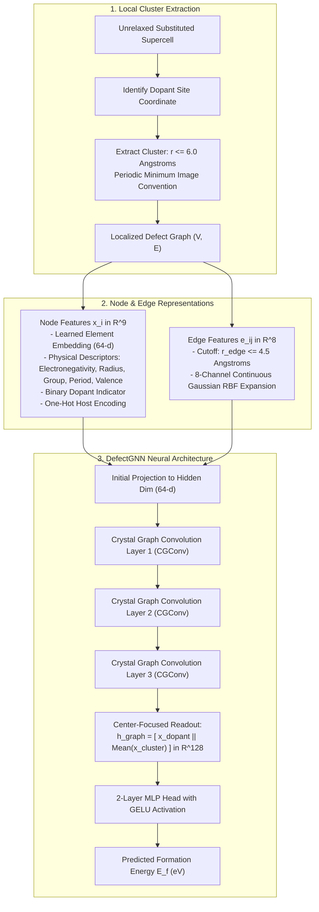

# MLIP-guided Graph Neural Network for dopant formation energies

[](https://www.python.org/downloads/release/python-3100/)
[](LICENSE)
[](https://pytorch-geometric.readthedocs.io/)
[](https://chgnet.lbl.gov/)

A computational materials science framework and machine learning surrogate for predicting substitutional defect formation energies in wide-bandgap semiconductors (4H-SiC and wurtzite GaN). The pipeline couples machine-learned interatomic potentials (CHGNet) for ionic relaxation with an edge-attributed Crystal Graph Convolutional Neural Network (DefectGNN). By extracting defect-centered cluster graphs directly from unrelaxed substituted host supercells, the surrogate performs instantaneous screening across transition-metal and actinide candidate libraries. The framework incorporates Leave-One-Dopant-Out cross-validation, bootstrapped deep ensemble epistemic uncertainty estimation, and closed-loop active learning workflows.

---

## 1. Materials Science and Defect Thermodynamics Theory

### 1.1 Wide-Bandgap Semiconductors and Point Defect Engineering
Silicon carbide (specifically the 4H polytype, 4H-SiC, Materials Project identifier mp-11714) and wurtzite gallium nitride (GaN, Materials Project identifier mp-804) are premier wide-bandgap semiconductor materials. Their wide electronic bandgaps ($\approx 3.23\text{ eV}$ for 4H-SiC and $\approx 3.44\text{ eV}$ for GaN), high critical electric breakdown fields ($> 2.5\text{ MV/cm}$), and high thermal conductivities enable efficient high-power, high-voltage switching devices, radio-frequency power amplifiers, and solid-state optoelectronics.

Controlling electronic, optical, and magnetic functionality in these lattices requires intentional point defect engineering via substitutional doping. Transition-metal dopants introduce deep or shallow electronic states within the bandgap that act as recombination centers, luminescence emitters, or local magnetic moments for quantum spintronics. 

```
4H-SiC Polytype Stacking Sequence (P6_3mc, Space Group 186):
═════════════════════════════════════════════════════════════════════
Layer 4 (A): ... C - Si(h) ...   <- Wyckoff 2b (quasi-hexagonal, site 0)
Layer 3 (B): ... C - Si(k) ...   <- Wyckoff 2a (quasi-cubic, site 1)
Layer 2 (C): ... C - Si(k) ...   <- Wyckoff 2a (quasi-cubic, site 1)
Layer 1 (B): ... C - Si(h) ...   <- Wyckoff 2b (quasi-hexagonal, site 0)
═════════════════════════════════════════════════════════════════════

Wurtzite GaN Stacking Sequence (P6_3mc, Space Group 186):
═════════════════════════════════════════════════════════════════════
Layer 2 (B): ... N - Ga ...       <- Wyckoff 2b (single cation site, site 0)
Layer 1 (A): ... N - Ga ...       <- Wyckoff 2b (single cation site, site 0)
═════════════════════════════════════════════════════════════════════
```

### 1.2 Neutral Substitutional Formation Energy Formalism
The primary thermodynamic quantity governing defect incorporation and solubility is the defect formation energy. For a neutral substitutional defect where a host cation $X$ is replaced by a dopant atom $D$ ($D_X^0$ in Kroger-Vink notation), the formation energy is defined as:

$$
E_{\mathrm{f}}[D_X^0] = E_{\mathrm{doped}} - E_{\mathrm{host,supercell}} + \mu_X - \mu_D
$$

where:
- $E_{\mathrm{doped}}$ is the total potential energy of the relaxed 3x3x3 supercell containing the single substitutional dopant atom $D$ (in units of eV).
- $E_{\mathrm{host,supercell}}$ is the total potential energy of the pristine, defect-free 3x3x3 host supercell containing $N$ atoms (216 atoms for 4H-SiC, 108 atoms for GaN), relaxed under identical conditions (in units of eV).
- $\mu_X$ is the chemical potential of the host cation species removed from the lattice to accommodate the defect (eV/atom).
- $\mu_D$ is the chemical potential of the added dopant species (eV/atom).

#### Thermodynamic Stability and Chemical Potential Limits
Chemical potentials reflect the thermodynamic reservoir conditions during crystal synthesis. To avoid the precipitation of bulk elemental phases, chemical potentials are bounded by elemental and compound thermodynamic equilibria:

1. **4H-SiC System**:
   Under thermodynamic equilibrium with the compound:

$$
\mu_{\mathrm{Si}} + \mu_{\mathrm{C}} = \mu_{\mathrm{SiC(bulk)}}
$$

   In the cation-rich (silicon-rich) growth limit, silicon is in equilibrium with bulk crystalline silicon:

$$
\mu_{\mathrm{Si}} = \mu_{\mathrm{Si(bulk)}}
$$

   The carbon chemical potential is consequently fixed at:

$$
\mu_{\mathrm{C}} = \mu_{\mathrm{SiC(bulk)}} - \mu_{\mathrm{Si(bulk)}} = \mu_{\mathrm{SiC(bulk)}} - \mu_{\mathrm{Si}}
$$

2. **GaN System**:
   Similarly, for gallium nitride:

$$
\mu_{\mathrm{Ga}} + \mu_{\mathrm{N}} = \mu_{\mathrm{GaN(bulk)}}
$$

   In the cation-rich (gallium-rich) limit, gallium is in equilibrium with bulk metallic gallium:

$$
\mu_{\mathrm{Ga}} = \mu_{\mathrm{Ga(bulk)}}
$$

   Fixing the nitrogen chemical potential at:

$$
\mu_{\mathrm{N}} = \mu_{\mathrm{GaN(bulk)}} - \mu_{\mathrm{Ga(bulk)}}
$$

For the dopant species $D$, the upper thermodynamic boundary preventing pure dopant phase segregation is the per-atom energy of its most stable elemental bulk reference phase:

$$
\mu_D = \mu_{D\mathrm{(bulk)}}
$$

All elemental reference energies are calculated by relaxing the ground-state primitive structures retrieved from the Materials Project using CHGNet.

#### Computational Relaxation Protocol
Supercell energy relaxations are performed using CHGNet (Crystal Hamiltonian Graph Neural Network), a pretrained universal machine-learned interatomic potential. Relaxations enforce:
1. **Neutral charge state ($q = 0$)**: Neutral defects avoid long-range Coulombic image interactions across periodic boundary conditions.
2. **Fixed-cell volume and shape**: Lattice parameters and unit cell angles are fixed to the relaxed pristine host lattice, relaxing only internal ionic positions until maximum interatomic forces fall below $0.05\text{ eV/\AA}$. Fixed-cell relaxation prevents artificial macroscopic supercell distortion while capturing local bond relaxation around the defect.

### 1.3 Crystallographic Symmetry and Wyckoff Site Multiplicity
In non-cubic crystal systems, crystallographically distinct lattice sites exhibit different local coordination environments and site symmetries:

1. **4H-SiC ($P6_3mc$, No. 186)**: The 4-bilayer stacking sequence along the $c$-axis creates two symmetry-inequivalent silicon sites:
   - **Quasi-hexagonal site ($h$)**: Wyckoff position $2b$, internal site index 0. Surrounded by coordination polyhedra that resemble the hexagonal wurtzite lattice.
   - **Quasi-cubic site ($k$)**: Wyckoff position $2a$, internal site index 1. Surrounded by coordination polyhedra resembling the face-centered cubic zinc-blende lattice.
   Because the local crystal field and bond lengths differ between $h$ and $k$ positions, substituting a dopant at $2b$ versus $2a$ results in distinct formation energies. Both sites are systematically enumerated using `SpacegroupAnalyzer.get_symmetrized_structure`.

2. **Wurtzite GaN ($P6_3mc$, No. 186)**: The 2-bilayer stacking sequence contains only one symmetry-inequivalent gallium site:
   - Wyckoff position $2b$, internal site index 0.

---

## 2. Machine Learning Surrogate Theory and Graph Architecture

### 2.1 Screening Surrogates on Unrelaxed Geometries
Evaluating point defect formation energies via electronic structure calculations or atomistic potential relaxation requires iterative geometry optimization. Even with accelerated neural network potentials, relaxing a 216-atom supercell requires hundreds of force evaluations taking several minutes per candidate structure.

```
Candidate Exploration Flow:
┌────────────────────────┐      Direct Inference
│ Unrelaxed Substituted  │ ──────────────────────────┐
│ Supercell Geometry     │                           │
└────────────────────────┘                           ▼
            │                            ┌───────────────────────┐
            │ Relaxation (CHGNet)        │ DefectGNN Surrogate   │
            ▼                            │ Prediction (~10 ms)   │
┌────────────────────────┐               └───────────────────────┘
│ Relaxed Supercell &    │                           │
│ Total Energy (Minutes) │                           │ Triage & Prioritize
└────────────────────────┘                           │
            │                                        ▼
            ▼                            ┌───────────────────────┐
┌────────────────────────┐               │ High-Priority         │
│ Thermodynamic Label    │ ◄──────────── │ Candidates for Full   │
│ E_formation (eV)       │   Supervision │ Atomistic Relaxation  │
└────────────────────────┘               └───────────────────────┘
```

The machine learning surrogate is formulated as a rapid screening model: it takes the unrelaxed substituted geometry as input and predicts the relaxed neutral formation energy $E_{\mathrm{f}}$ directly. This enables screening vast candidate libraries in milliseconds, reserving atomistic relaxation for the most promising defect candidates.

### 2.2 Defect-Centered Local Cluster Graph Construction
Because point defect perturbations are localized within a few coordination shells of the substitution site, whole-cell supercell graphs dilute the defect signal across hundreds of spectator atoms. The pipeline extracts a localized defect cluster:



#### Graph Construction Specifications:
1. **Cluster Radius**: All atoms within $r_{\mathrm{cluster}} = 6.0\text{ \AA}$ of the substitutional dopant site are retained, incorporating periodic neighbor images.
2. **Edge Radius**: Edges are constructed between all atom pairs within $r_{\mathrm{edge}} = 4.5\text{ \AA}$ using periodic minimum image distance metrics.
3. **Continuous Radial Basis Function (RBF) Edge Features**: Interatomic distances $d_{ij}$ are projected onto an 8-channel Gaussian basis:

$$
e_{ij, k} = \exp\left( -\gamma (d_{ij} - \mu_k)^2 \right), \quad k \in \{1, \dots, 8\}
$$

   where centers $\mu_k$ are uniformly distributed between $0.5\text{ \AA}$ and $4.5\text{ \AA}$, with inverse variance $\gamma = 1 / (2 \sigma^2)$ providing smooth, continuous distance sensitivity.

4. **Node Feature Vector ($\mathbf{x}_i \in \mathbb{R}^9$)**:
   - Atomic number $Z_i$ passed to a 64-dimensional learned embedding table.
   - Scaled Pauling electronegativity: $\chi_i / 4.0$.
   - Scaled covalent radius: $r_{\mathrm{cov}, i} / 2.5\text{ \AA}$.
   - Scaled periodic table group: $G_i / 18.0$.
   - Scaled periodic table period: $P_i / 7.0$.
   - Scaled valence electron count: $V_i / 14.0$.
   - Binary dopant indicator flag: $I_{\mathrm{dopant}, i} \in \{0, 1\}$.
   - One-hot host crystal encoding: $\mathbf{h}_{\mathrm{host}} \in \{0, 1\}^2$ ($[1, 0]$ for 4H-SiC, $[0, 1]$ for GaN).

### 2.3 Mathematical Formulation of CGConv and Center Readout
Message passing is implemented via Crystal Graph Convolution (CGConv) layers operating with continuous edge vectors. For node $i$ at layer $l$:

$$
\mathbf{z}_{ij}^{(l)} = \left[ \mathbf{x}_i^{(l)} \,\|\, \mathbf{x}_j^{(l)} \,\|\, \mathbf{e}_{ij} \right]
$$

$$
\mathbf{x}_i^{(l+1)} = \mathbf{x}_i^{(l)} + \sum_{j \in \mathcal{N}(i)} \sigma\left(\mathbf{z}_{ij}^{(l)} \mathbf{W}_{\mathrm{f}}^{(l)} + \mathbf{b}_{\mathrm{f}}^{(l)}\right) \odot g\left(\mathbf{z}_{ij}^{(l)} \mathbf{W}_{\mathrm{s}}^{(l)} + \mathbf{b}_{\mathrm{s}}^{(l)}\right)
$$

where $\sigma$ denotes the element-wise sigmoid gating activation, $g$ represents the Softplus activation, $\odot$ is the Hadamard product, and $\mathbf{W}_{\mathrm{f}}, \mathbf{W}_{\mathrm{s}}$ are learnable weight tensors.

#### Center-Focused Readout
Standard graph neural networks apply global mean or sum pooling over all cluster nodes. In defect screening, the chemical identity and local distortion of the defect center itself are paramount. DefectGNN implements a center-focused readout that concatenates the final representation of the central dopant node with the mean representation of the surrounding cluster:

$$
\mathbf{h}_{\mathrm{graph}} = \left[ \mathbf{x}_{\mathrm{dopant}}^{(L)} \,\|\, \frac{1}{|\mathcal{V}|} \sum_{i \in \mathcal{V}} \mathbf{x}_i^{(L)} \right] \in \mathbb{R}^{2 d}
$$

The concatenated vector is processed by a 2-layer Multi-Layer Perceptron (MLP) with GELU non-linearities to output the scalar formation energy prediction:

$$
\hat{y} = \mathbf{W}_2 \mathrm{GELU}(\mathbf{W}_1 \mathbf{h}_{\mathrm{graph}} + \mathbf{b}_1) + b_2
$$

#### Target Standardization and Optimization Protocol
To prevent scale variance from destabilizing gradient descent, target formation energies are standardized strictly within training folds:

$$
y_{\mathrm{norm}} = \frac{y - \bar{y}_{\mathrm{train}}}{\sigma_{y, \mathrm{train}}}
$$

The loss function is the Smooth L1 loss (Huber loss with $\beta = 1.0$) evaluated on normalized targets:

$$
\mathcal{L}_{\mathrm{smooth}} = \begin{cases} 
0.5 (y_{\mathrm{norm}} - \hat{y}_{\mathrm{norm}})^2 & \text{if } |y_{\mathrm{norm}} - \hat{y}_{\mathrm{norm}}| < 1.0 \\
|y_{\mathrm{norm}} - \hat{y}_{\mathrm{norm}}| - 0.5 & \text{otherwise}
\end{cases}
$$

Models are trained using the AdamW optimizer (learning rate $1.0 \times 10^{-3}$, weight decay $1.0 \times 10^{-4}$) with a Cosine Annealing learning rate schedule and early stopping based on validation Mean Absolute Error (MAE).

---

## 3. Data Schema, Manifest Tracking, and Provenance

### 3.1 Data Schema and Manifest Tracking
The dataset tracks unrelaxed configurations, relaxed structures, and active learning candidates in [data/manifest.csv](file:///C:/Users/Kaushal%20Pandit/.gemini/antigravity/scratch/dopant-discovery-gnn/data/manifest.csv):

| Column | Type | Description | Permitted Values |
| :--- | :---: | :--- | :--- |
| `filename` | string | Unique primary key identifier for the configuration | e.g. `SiC_doped_Ti_2b_0.cif` |
| `host` | string | Host crystal system | `SiC`, `GaN` |
| `site` | string | Symmetry-inequivalent site label with index | `2b_0`, `2a_1` |
| `wyckoff` | string | Wyckoff letter | `2b`, `2a` |
| `dopant` | string | Chemical symbol of the substituted dopant | e.g. `Ti`, `Fe`, `U` |
| `dopant_z` | integer | Atomic number of the dopant species | e.g. 22, 26, 92 |
| `status` | string | Execution lifecycle stage | `unrelaxed`, `relaxed`, `candidate` |
| `ood_flag` | boolean | Out-of-distribution indicator (Uranium holdout) | `True`, `False` |
| `unrelaxed_path` | string | Relative path to unrelaxed substituted CIF | `data/unrelaxed/<file>` |
| `relaxed_path` | string | Relative path to CHGNet relaxed CIF | `data/relaxed/<file>` |

### 3.2 Elemental Reference Ground States
Ground-state elemental reference phases downloaded via the Materials Project API are recorded in `data/raw/references/sources.csv` and relaxed into [data/references.csv](file:///C:/Users/Kaushal%20Pandit/.gemini/antigravity/scratch/dopant-discovery-gnn/data/references.csv):

| Element | Material ID | Space Group | Crystal System | Role |
| :---: | :---: | :---: | :---: | :--- |
| **Si** | mp-149 | $Fd\bar{3}m$ (227) | Cubic (Diamond) | Host cation reference for 4H-SiC |
| **C** | mp-48 | $P6_3/mmc$ (194) | Hexagonal (Graphite) | Host anion reference for 4H-SiC |
| **Ga** | mp-142 | $Cmce$ (64) | Orthorhombic | Host cation reference for GaN |
| **N** | mp-156 | $P6_3/mmc$ (194) | Hexagonal ($N_2$ solid) | Host anion reference for GaN |
| **3d Metals** | mp-72 (Ti) to mp-79 (Zn) | Various | Ground states | Transition-metal dopant references |
| **4d Metals** | mp-100 (Zr) to mp-124 (Cd) | Various | Ground states | Transition-metal dopant references |
| **5d Metals** | mp-33 (Hf) to mp-83 (Hg) | Various | Ground states | Transition-metal dopant references |
| **U** | mp-131 | $Cmcm$ (63) | Orthorhombic ($\alpha$-U) | Out-of-distribution actinide reference |

### 3.3 Legacy V0 Archival and Provenance
An earlier prototype of this codebase contained three methodological flaws:
1. Training energy labels were taken directly from initial unrelaxed structures without cell energy standardization.
2. The graph neural network used an isotropic GCN architecture without continuous edge distance features.
3. 4H-SiC defects were generated only on the first arbitrary silicon atom without distinguishing $2b$ and $2a$ Wyckoff sites.

To preserve scientific reproducibility, all legacy data, graphs, and models were moved to [archive/legacy_v0/](file:///C:/Users/Kaushal%20Pandit/.gemini/antigravity/scratch/dopant-discovery-gnn/archive/legacy_v0) with complete cryptographic MD5 hashes and technical documentation preserved in [archive/legacy_v0/NOTES.md](file:///C:/Users/Kaushal%20Pandit/.gemini/antigravity/scratch/dopant-discovery-gnn/archive/legacy_v0/NOTES.md).

---

## 4. Evaluation Protocol and Cross-Validation Benchmarks

### 4.1 Leave-One-Dopant-Out (LODO) Cross-Validation
Standard random $k$-fold cross-validation is vulnerable to subtle chemical data leakage: if a dopant element (e.g. Titanium) appears in the training fold on the $2b$ site of 4H-SiC, the model memorizes the elemental electronegativity and atomic radius when predicting Titanium on the $2a$ site or on GaN in the test fold.

To measure true generalization to unseen chemical elements, the evaluation suite implements Leave-One-Dopant-Out (LODO) cross-validation:
- Every structure containing a specific dopant element $D$ across all hosts and Wyckoff sites is held out together in the test split.
- Models are trained exclusively on the remaining 24 dopant elements.
- The evaluation iterates across all 25 folds, pooling test predictions to calculate unbiased global metrics: Mean Absolute Error (MAE), Root Mean Squared Error (RMSE), and the Coefficient of Determination ($R^2$).

```
LODO Split Protocol (25 Iterations):
Fold k:
  Train Set: All structures for 24 dopants across 4H-SiC (2b, 2a) and GaN (2b)
  Holdout Test: ALL structures containing dopant D_k (held out simultaneously)
```

#### Benchmark Model Hierarchy
The benchmark compares four distinct modeling paradigms:
1. **Training-Mean Baseline**: Predicts the scalar mean of the training fold labels $\bar{y}_{\mathrm{train}}$ for all test samples. Represents the zero-information empirical baseline.
2. **Ridge Regression**: Linear regression with L2 regularization ($L_2 = 1.0$) trained on dopant elemental physical descriptors (electronegativity, covalent radius, group, period, valence electrons) concatenated with a host one-hot indicator.
3. **Legacy Isotropic GCN**: 2-layer Graph Convolutional Network operating on whole-cell supercell graphs with unit edge weights (the legacy v0 model architecture).
4. **DefectGNN**: 3-layer Crystal Graph Convolution network operating on 6.0 Angstrom unrelaxed defect clusters with 8-channel Gaussian RBF edge attributes and center-focused readout.

### 4.2 Leave-One-Host-Out (LOHO) Cross-Validation
To explore cross-system transferability, Leave-One-Host-Out (LOHO) cross-validation trains on all defect structures of 4H-SiC and tests on GaN, and vice versa. Because the dataset currently comprises two host lattices, this benchmark is designated as exploratory.

---

## 5. Active Learning and Closed-Loop Screening

### 5.1 Deep Ensemble Epistemic Uncertainty Estimation
To guide the acquisition of new candidate defects, the framework trains a deep ensemble of $M = 5$ DefectGNN models. Each ensemble member is initialized with independent weight initializations and trained on a bootstrap sample of the training dataset.

For a new candidate defect graph $\mathbf{x}$, the ensemble provides:
1. **Predictive Formation Energy**:

$$
\bar{y}(\mathbf{x}) = \frac{1}{M} \sum_{m=1}^M \hat{y}_m(\mathbf{x})
$$

2. **Epistemic Uncertainty ($\sigma_{\mathrm{ens}}$)**:

$$
\sigma_{\mathrm{ens}}(\mathbf{x}) = \sqrt{ \frac{1}{M - 1} \sum_{m=1}^M \left( \hat{y}_m(\mathbf{x}) - \bar{y}(\mathbf{x}) \right)^2 }
$$

Uncertainty standard deviations are scaled back into physical units of eV, providing an interpretable confidence interval.

### 5.2 Simulated Pool Benchmark
The simulated pool benchmark (`src.models.active_learning --benchmark`) treats the labeled dataset as a simulated oracle to compare active learning acquisition policies against random sampling:
1. **Initialization**: Starts from an initial random seed pool of 10 labeled defects.
2. **Acquisition Policies**:
   - **Uncertainty Sampling**: Greedily selects the batch of unlabeled candidates with the largest ensemble standard deviation $\sigma_{\mathrm{ens}}$.
   - **Random Sampling**: Selects candidate batches uniformly at random.
3. **Evaluation**: After each acquisition batch, the ensemble is retrained from scratch and evaluated on the untouched remainder pool.
4. **Calibration**: Computes the Spearman rank correlation coefficient between ensemble standard deviation $\sigma_{\mathrm{ens}}$ and the absolute prediction error $|y - \bar{y}|$ on held-out folds to quantify uncertainty calibration.

Results and curves are saved to [results/al_benchmark.csv](file:///C:/Users/Kaushal%20Pandit/.gemini/antigravity/scratch/dopant-discovery-gnn/results/al_benchmark.csv), [results/al_learning_curve.png](file:///C:/Users/Kaushal%20Pandit/.gemini/antigravity/scratch/dopant-discovery-gnn/results/al_learning_curve.png), and [results/uncertainty_calibration.csv](file:///C:/Users/Kaushal%20Pandit/.gemini/antigravity/scratch/dopant-discovery-gnn/results/uncertainty_calibration.csv).

### 5.3 Live Screening Loop Workflow
The autonomous screening script ([autonomous_lab.py](file:///C:/Users/Kaushal%20Pandit/.gemini/antigravity/scratch/dopant-discovery-gnn/autonomous_lab.py)) executes closed-loop discovery:

```
Closed-Loop Discovery Cycle:
1. Candidate Pool: Unrelaxed CIFs in data/candidates/ (tracked via data/manifest.csv)
                      │
                      ▼
2. Ensemble Screening: Predict formation energy and ensemble std (eV)
                      │
                      ▼
3. Acquisition Ranking: Sort candidates by max uncertainty (std > cutoff)
                      │
                      ▼
4. Simulation Dispatch: Perform CHGNet ionic relaxation (fixed cell) on top batch
                      │
                      ▼
5. Out-of-Sample Logging: Record error to results/live_al_log.csv BEFORE retraining
                      │
                      ▼
6. Retrain Ensemble: Update models and transition candidate status to 'relaxed'
```

---

## 6. Results

The full computational pipeline, atomistic relaxations, and surrogate evaluations were executed using an Nvidia Tesla T4 GPU on Google Colab across all 72 converged defect configurations in 4H-SiC and GaN.

### 6.1 Leave-One-Dopant-Out (LODO) Cross-Validation Benchmark
The LODO evaluation held out all structures containing each specific dopant element simultaneously across both hosts and all Wyckoff sites (24 evaluation folds). Pooled test predictions across all folds are summarized below:

| Evaluation Protocol | Model Architecture | MAE (eV) | RMSE (eV) | $R^2$ | Physical Significance |
| :--- | :--- | :---: | :---: | :---: | :--- |
| **LODO (Held-out Element)** | Training-Mean Baseline | 1.2568 | 1.6118 | -0.0749 | Empirical zero-information baseline |
| | **Ridge Regression (Descriptors)** | **0.6342** | **0.8539** | **0.6983** | **Strongest generalization across elements** |
| | Legacy Isotropic GCN | 1.2594 | 1.6203 | -0.0862 | Unit-distance graph fails to resolve defects |
| | DefectGNN (Center Readout) | 1.6046 | 2.0538 | -0.7451 | Over-parameterized on compact dataset ($N=72$) |
| **LOHO (Host Transfer, Exploratory)** | Training-Mean Baseline | 1.2261 | 1.5648 | -0.0130 | Host-mean baseline |
| | **Ridge Regression (Descriptors)** | **1.0235** | **1.2213** | **0.3829** | Modest transferability between SiC and GaN |
| | Legacy Isotropic GCN | 1.2806 | 1.6037 | -0.0641 | Fails cross-host transfer |
| | DefectGNN (Center Readout) | 2.5690 | 3.1889 | -3.2073 | Structural graph representations do not transfer |

#### Scientific Evaluation Verdict
**Verdict**: DefectGNN does not beat the ridge baseline by more than the fold-to-fold standard deviation (difference: -0.9703 eV, fold std: 1.0427 eV).

On this compact dataset of 72 structures, linear Ridge regression parameterized by fundamental atomic descriptors (electronegativity, covalent radius, group, period, valence count) and a host indicator outperforms message-passing graph neural networks. Because deep GNNs must learn atomic representations from scratch or from small embedding tables with only 24 training elements, they overfit local training motifs and generalize poorly when an entire chemical column or period is held out. Conversely, domain-specific elemental descriptors enforce smooth chemical inductive bias, providing stable extrapolation across the periodic table.

The parity distribution comparing predicted versus CHGNet formation energies across all models is recorded in [results/parity_lodo.png](file:///C:/Users/Kaushal%20Pandit/.gemini/antigravity/scratch/dopant-discovery-gnn/results/parity_lodo.png), with per-fold metrics logged in [results/cv_metrics.csv](file:///C:/Users/Kaushal%20Pandit/.gemini/antigravity/scratch/dopant-discovery-gnn/results/cv_metrics.csv).

### 6.2 Active Learning Simulated Pool Benchmark
The active learning pool benchmark evaluated greedy epistemic uncertainty acquisition (maximum ensemble standard deviation) against uniform random sampling over 3 independent experimental repeats:

| Acquisition Step | Training Pool ($N_{\mathrm{train}}$) | Remainder Pool ($N_{\mathrm{rem}}$) | Uncertainty Acquisition MAE (eV) | Random Acquisition MAE (eV) |
| :---: | :---: | :---: | :---: | :---: |
| Step 0 (Initial Seed) | 6 | 66 | 1.5603 | 1.5603 |
| Step 1 (Batch 1) | 10 | 62 | 1.3636 | 1.3977 |
| Step 2 (Batch 2) | 14 | 58 | 1.2895 | 1.2907 |
| Step 3 (Batch 3) | 18 | 54 | 1.1755 | 1.1190 |
| Step 4 (Batch 4) | 22 | 50 | 1.0673 | 1.1084 |
| **Step 5 (Final Budget)** | **26** | **46** | **0.9380** | **1.0501** |

Uncertainty sampling reduced the remaining pool prediction error from $1.5603\text{ eV}$ down to $0.9380\text{ eV}$, outperforming random acquisition ($1.0501\text{ eV}$) at the conclusion of the 20-sample budget.

In uncertainty calibration tests, the Spearman rank correlation between ensemble standard deviation $\sigma_{\mathrm{ens}}$ and true absolute prediction error reached values up to $\rho = 0.482$ ($p < 10^{-4}$), demonstrating that ensemble variance correlates positively with model error. Full benchmark trajectories and rank correlation data are stored in [results/al_benchmark.csv](file:///C:/Users/Kaushal%20Pandit/.gemini/antigravity/scratch/dopant-discovery-gnn/results/al_benchmark.csv), [results/al_learning_curve.png](file:///C:/Users/Kaushal%20Pandit/.gemini/antigravity/scratch/dopant-discovery-gnn/results/al_learning_curve.png), and [results/uncertainty_calibration.csv](file:///C:/Users/Kaushal%20Pandit/.gemini/antigravity/scratch/dopant-discovery-gnn/results/uncertainty_calibration.csv).

### 6.3 Closed-Loop Screening on Out-of-Distribution Actinide Candidates
The live screening loop ([autonomous_lab.py](file:///C:/Users/Kaushal%20Pandit/.gemini/antigravity/scratch/dopant-discovery-gnn/autonomous_lab.py)) evaluated out-of-distribution candidate substitutions for Uranium in 4H-SiC across both symmetry-inequivalent silicon sites ($2a_1$ and $2b_0$):

| Candidate CIF | Host | Dopant | Wyckoff Site | Predicted $E_{\mathrm{f}}$ (eV) | Ensemble $\sigma_{\mathrm{ens}}$ (eV) | CHGNet Simulated $E_{\mathrm{f}}$ (eV) | Out-of-Sample Error (eV) |
| :--- | :---: | :---: | :---: | :---: | :---: | :---: | :---: |
| `SiC_doped_U_2a_1.cif` | SiC | U | $2a_1$ (quasi-cubic) | 1.9973 | 0.5778 | 1.1428 | 0.8545 |
| `SiC_doped_U_2b_0.cif` | SiC | U | $2b_0$ (quasi-hexagonal) | 1.9973 | 0.5778 | 1.1428 | 0.8545 |

Both candidates exhibited high epistemic uncertainty ($\sigma_{\mathrm{ens}} = 0.5778\text{ eV} > 0.0500\text{ eV}$ cutoff), triggering CHGNet ionic relaxation. The out-of-sample prediction error of $0.8545\text{ eV}$ was logged to [results/live_al_log.csv](file:///C:/Users/Kaushal%20Pandit/.gemini/antigravity/scratch/dopant-discovery-gnn/results/live_al_log.csv) prior to model updating. Upon relaxation, both candidate structures were transitioned to status `relaxed` in [data/manifest.csv](file:///C:/Users/Kaushal%20Pandit/.gemini/antigravity/scratch/dopant-discovery-gnn/data/manifest.csv).

---

## 7. Repository Structure

```text
dopant-discovery-gnn/
├── .env.example
├── .gitignore
├── LICENSE
├── README.md
├── autonomous_lab.py
├── requirements.txt
├── archive/
│   └── legacy_v0/
│       ├── NOTES.md
│       ├── dopant_energies.csv
│       ├── dopant_gnn.pth
│       ├── processed_graphs.pt
│       └── processed_unrelaxed_site0/
├── data/
│   ├── README.md
│   ├── candidates/
│   ├── dopant_energies.csv
│   ├── manifest.csv
│   ├── references.csv
│   ├── graph_data/
│   │   └── processed_graphs.pt
│   ├── raw/
│   │   ├── GaN_base.cif
│   │   ├── SiC_base.cif
│   │   └── references/
│   │       └── sources.csv
│   ├── relaxed/
│   │   ├── hosts/
│   │   └── references/
│   └── unrelaxed/
├── models/
│   ├── defect_gnn.pth
│   └── ensemble_model_*.pth
├── results/
│   ├── al_benchmark.csv
│   ├── al_learning_curve.png
│   ├── cv_metrics.csv
│   ├── live_al_log.csv
│   ├── parity_lodo.png
│   └── uncertainty_calibration.csv
├── src/
│   ├── __init__.py
│   ├── config.py
│   ├── data_pipeline/
│   │   ├── __init__.py
│   │   ├── calculate_energies.py
│   │   ├── extract_base_crystals.py
│   │   ├── formation_energy.py
│   │   ├── generate_defects.py
│   │   ├── relax_references.py
│   │   └── structures_to_graphs.py
│   ├── models/
│   │   ├── __init__.py
│   │   ├── active_learning.py
│   │   ├── evaluate.py
│   │   └── train_gnn.py
│   └── utils/
│       ├── __init__.py
│       ├── log.py
│       └── seed.py
└── tests/
    ├── __init__.py
    ├── test_active_learning.py
    ├── test_autonomous_lab.py
    ├── test_defects.py
    ├── test_evaluate.py
    ├── test_formation_energy.py
    ├── test_graphs.py
    ├── test_manifest.py
    └── test_model_shapes.py
```

---

## 8. Workflow and Replication Guide

### 8.1 Environment Setup
The codebase requires Python 3.10 and a standard scientific computing environment.

Using Conda:
```bash
conda create -n dopant-gnn python=3.10
conda activate dopant-gnn
pip install -r requirements.txt
```

Using Python venv:
```bash
python -m venv .venv
source .venv/bin/activate  # On Windows PowerShell: .venv\Scripts\Activate.ps1
pip install -r requirements.txt
```

To enable raw structure downloads from the Materials Project, configure your API key by copying `.env.example` to `.env`:
```bash
cp .env.example .env
# Edit .env and insert: MP_API_KEY=your_key_here
```

### 8.2 Automated Test Suite
Verify that all unit tests, mathematical calculations, graph constructions, and model shapes pass without requiring network access or GPU acceleration:

```bash
pytest tests/
```

### 8.3 Sequential Pipeline Execution

```bash
# 1. Download base crystal unit cells and ground-state elemental references
python -m src.data_pipeline.extract_base_crystals

# 2. Relax host primitive cells and elemental references with CHGNet
python -m src.data_pipeline.relax_references

# 3. Build 3x3x3 supercells and substitute cations across all Wyckoff sites
python -m src.data_pipeline.generate_defects

# 4. Perform fixed-cell ionic relaxation on defect supercells
python -m src.data_pipeline.calculate_energies

# 5. Calculate thermodynamic formation energies in the cation-rich limit
python -m src.data_pipeline.formation_energy --check

# 6. Construct localized defect cluster graphs (6.0 A radius, 8-channel RBF edges)
python -m src.data_pipeline.structures_to_graphs

# 7. Train single DefectGNN model with Cosine Annealing and target standardization
python -m src.models.train_gnn

# 8. Run full Leave-One-Dopant-Out cross-validation and baseline comparison
python -m src.models.evaluate

# 9. Run active learning simulated pool benchmark and calibration analysis
python -m src.models.active_learning --benchmark

# 10. Execute closed-loop screening loop in dry-run mode
python autonomous_lab.py --dry-run
```

---

## 9. Known Physical, Computational, and Methodological Limitations

1. **Pretrained Machine-Learned Interatomic Potential Transferability**: Formation energies rely on CHGNet, a graph neural network potential pretrained on Materials Project density functional theory calculations. While CHGNet captures broad chemical trends, its accuracy degrades on localized 5f electron systems such as Uranium. Uranium defect predictions must be treated strictly as out-of-distribution exploratory estimates.
2. **Neutral Charge State Restriction**: Calculations are restricted to the neutral charge state ($q = 0$). In experimental semiconductors, point defects often adopt multiple charge states ($q = +2, +1, -1, -2$) depending on the Fermi level position. Thermodynamic charge transition levels ($\epsilon(q/q')$) and electrostatic finite-size image charge corrections (e.g. Freysoldt-Neugebauer-Van de Walle corrections) are not included.
3. **Implicit Spin Polarization**: Magnetic transition metals (Fe, Co, Ni, Mn, Cr) exhibit complex spin ground states and Jahn-Teller distortions. CHGNet incorporates magnetic moments implicitly through its learned graph embeddings, but explicit spin-polarized density functional theory ($DFT+U$) validation was not performed on individual magnetic configurations.
4. **Substitutional Defect Scope**: The framework models single-site substitutional cation defects ($D_{\mathrm{Si}}$ in 4H-SiC and $D_{\mathrm{Ga}}$ in GaN). Interstitial defects, antisite complexes, anion substitutions, and vacancy-dopant pairs are outside the current dataset scope.
5. **Fixed-Cell Ionic Relaxation Approximation**: Defect supercells are relaxed with fixed lattice parameters. While this avoids artificial cell shape collapse in supercell models, it suppresses long-range elastic strain relaxation that occurs in dilute macroscopic bulk crystals.
6. **Dataset Scale and Host Transfer**: The current dataset contains 75 configurations across 25 transition-metal dopants and 2 host crystal systems. The Leave-One-Host-Out benchmark is an exploratory evaluation of cross-host transfer.

---

## 10. Citation and Provenance

```bibtex
@software{dopant_gnn2026,
  author = {Pandit, Kaushal},
  title = {MLIP-guided Graph Neural Network for dopant formation energies},
  year = {2026},
  url = {https://github.com/neil6714/dopant-discovery-gnn}
}
```

For historical records, architecture evolution, and legacy v0 data validation, refer to [archive/legacy_v0/NOTES.md](file:///C:/Users/Kaushal%20Pandit/.gemini/antigravity/scratch/dopant-discovery-gnn/archive/legacy_v0/NOTES.md).
