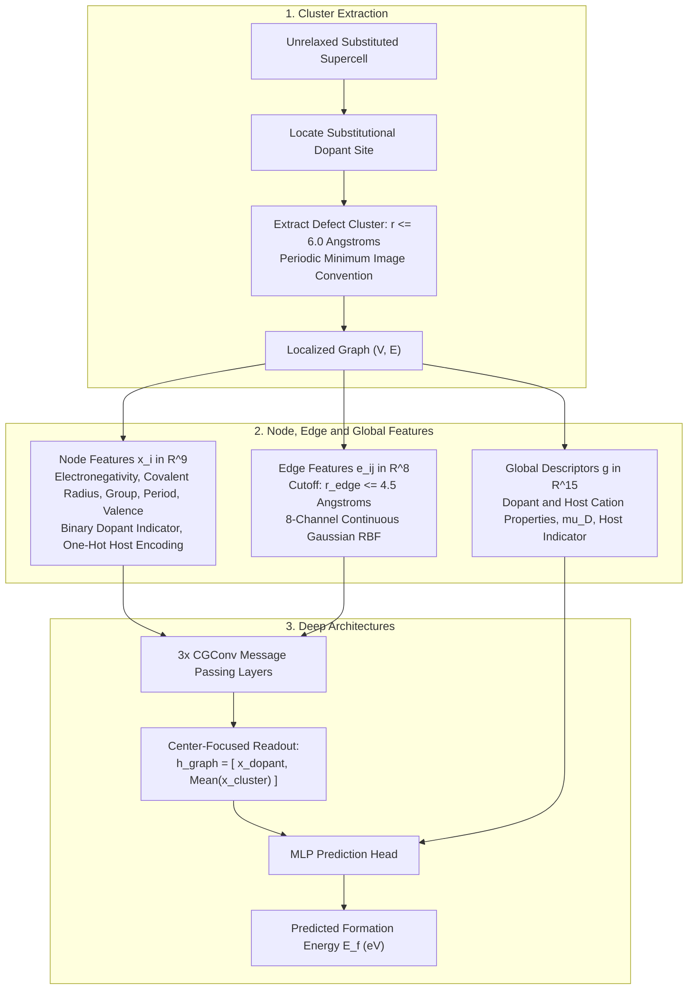

# MLIP-guided Graph Neural Network for dopant formation energies

[](https://github.com/neil6714/dopant-discovery-gnn/actions)
[](tests/)
[](https://www.python.org/downloads/release/python-3100/)
[](https://pytorch-geometric.readthedocs.io/)
[](https://chgnet.lbl.gov/)
[](https://www.nvidia.com/)
[](https://materialsproject.org/)
[](LICENSE)

This project tests machine learning models to predict how much energy it takes to substitute dopant atoms into wide-bandgap semiconductors (4H-SiC and wurtzite GaN). We use CHGNet, a pretrained machine-learned interatomic potential (MLIP), to relax defect structures and calculate reference formation energies. Then, we test whether a Graph Neural Network (DefectGNN) can predict these relaxed energies directly from unrelaxed defect clusters in milliseconds. We investigate why standard GNNs struggle to generalize to unseen chemical elements, evaluate physically motivated descriptor fixes, and test the models inside an active learning loop.

---

## 1. Materials Science and Defect Thermodynamics

### 1.1 Wide-Bandgap Semiconductors and Dopants
Silicon carbide (4H-SiC, Materials Project mp-11714) and gallium nitride (GaN, Materials Project mp-804) are wide-bandgap semiconductors with bandgaps of 3.23 eV for 4H-SiC and 3.44 eV for GaN. Because they tolerate high voltages and temperatures, they are widely used in electric vehicles, power grids, and radio-frequency electronics. Doping them with transition metals or main-group elements introduces localized energy levels in the bandgap, which can act as color centers, spin qubits, or luminescence emitters.

Both crystals share the hexagonal space group $P6_3mc$ (No. 186), but differ in how their atomic layers stack:
- **4H-SiC**: A four-bilayer stacking sequence along the $c$-axis creates two distinct silicon sites:
  - Quasi-hexagonal site ($h$): Wyckoff position $2b$, site index 0.
  - Quasi-cubic site ($k$): Wyckoff position $2a$, site index 1.
- **Wurtzite GaN**: A two-bilayer stacking sequence contains only one distinct gallium site:
  - Wyckoff position $2b$, site index 0.

Because the neighboring atoms are arranged differently around the $2b$ and $2a$ sites in SiC, dopants experience different local strain and bonding, giving them different formation energies. Symmetrized sites are found with `pymatgen` and mapped to supercell coordinates by Cartesian position.

### 1.2 Neutral Substitutional Formation Energy Formula
For a neutral defect where a host cation $X$ (Si or Ga) is replaced by a dopant $D$ ($D_X^0$ in Kroger-Vink notation), the formation energy is:

$$
E_{\mathrm{f}}[D_X^0] = E_{\mathrm{doped}} - E_{\mathrm{host, supercell}} + \mu_X - \mu_D
$$

where:
- $E_{\mathrm{doped}}$ is the total energy of the relaxed 3x3x3 supercell containing the dopant (eV).
- $E_{\mathrm{host, supercell}}$ is the relaxed energy of the pristine host supercell (216 atoms for 4H-SiC, 108 atoms for GaN).
- $\mu_X$ is the host cation chemical potential (eV/atom).
- $\mu_D$ is the dopant chemical potential (eV/atom).

#### Chemical Potential Boundaries (Cation-Rich Limit)
Chemical potentials represent the reservoir conditions during synthesis. To prevent the host or dopants from precipitating into bulk elemental crystals, chemical potentials have thermodynamic bounds:
- **4H-SiC**: Under compound equilibrium, the cation-rich (Si-rich) limit fixes:
  $$
  \mu_{\text{Si}} + \mu_{\text{C}} = \mu_{\text{SiC}} \implies \mu_{\text{Si}} = \mu_{\text{Si(bulk)}}, \quad \mu_{\text{C}} = \mu_{\text{SiC(bulk)}} - \mu_{\text{Si(bulk)}}
  $$
- **GaN**: Under compound equilibrium, the cation-rich (Ga-rich) limit fixes:
  $$
  \mu_{\text{Ga}} + \mu_{\text{N}} = \mu_{\text{GaN}} \implies \mu_{\text{Ga}} = \mu_{\text{Ga(bulk)}}, \quad \mu_{\text{N}} = \mu_{\text{GaN(bulk)}} - \mu_{\text{Ga(bulk)}}
  $$
- **Dopant**: The upper solubility limit before pure dopant phase segregation is set by its bulk elemental ground state:
  $$
  \mu_D = \mu_{D\text{(bulk)}}
  $$

### 1.3 Role of Machine-Learned Interatomic Potentials (CHGNet)
Density Functional Theory (DFT) calculations on 216-atom supercells are computationally expensive, taking hours per structure. In this project, we use CHGNet (Crystal Hamiltonian Graph Neural Network) as our atomistic simulation engine. CHGNet is a universal machine-learned interatomic potential trained on over 1.5 million Materials Project DFT calculations. It predicts total energies, interatomic forces, and stress tensors directly from atomic structures in seconds.

CHGNet plays three central roles in this pipeline:
1. **Reference calculations**: It relaxes host unit cells, pristine supercells, and ground-state elemental reference phases for all 33 dopants, providing consistent chemical potentials ($\mu$).
2. **Defect relaxations**: For every substituted defect supercell, it relaxes atomic positions at clamped cell volume until maximum forces fall below $0.05\text{ eV/\AA}$. Fixed-cell relaxation allows local bonds to relax around the dopant while preventing artificial box deformation in periodic boundary conditions.
3. **Simulation engine for active learning**: When the surrogate model encounters a candidate with high uncertainty, CHGNet automatically relaxes the structure to generate ground truth.

This pairs an MLIP with a surrogate: CHGNet replaces slow DFT calculations (minutes instead of hours), while DefectGNN acts as a rapid screening filter (~10 milliseconds) to select which structures are worth relaxing with CHGNet.

---

## 2. Surrogate Model Theory and Graph Architecture

### 2.1 Screening on Unrelaxed Geometries
Even with neural network potentials, relaxing large supercells takes time. A surrogate model bypasses relaxation entirely during initial exploration: it takes unrelaxed substituted supercells (which are generated instantly in code) and predicts the relaxed formation energy $E_{\mathrm{f}}$ in milliseconds. This allows fast screening of large candidate libraries.



### 2.2 Local Cluster Graphs and Features
Point defect strain decays rapidly with distance. Passing an entire 216-atom supercell into a GNN dilutes the defect signal across hundreds of spectator atoms. Instead, we extract a localized cluster around the defect:
1. **Cluster cutoff**: Keep atoms within $6.0\text{ \AA}$ of the dopant site under periodic boundary conditions.
2. **Edge cutoff**: Connect any pair of atoms within $4.5\text{ \AA}$.
3. **Radial Basis Function (RBF) edges**: Interatomic distances $d_{ij}$ are expanded on an 8-channel Gaussian basis:

$$
e_{ij, k} = \exp\left( -\gamma (d_{ij} - \mu_k)^2 \right), \quad k \in \{1, \dots, 8\}
$$

with centers $\mu_k$ spaced from $0.5\text{ \AA}$ to $4.5\text{ \AA}$ and $\gamma = 1 / (2 \sigma^2)$.

4. **Node features** ($\mathbf{x}_i \in \mathbb{R}^9$): Scaled Pauling electronegativity ($\chi / 4.0$), covalent radius ($r / 2.5\text{ \AA}$), periodic group ($G / 18.0$), period ($P / 7.0$), valence electrons ($V / 14.0$), a binary dopant indicator (1 for dopant, 0 for host), and a host one-hot indicator ([1, 0] for SiC, [0, 1] for GaN).
5. **Global descriptors** ($\mathbf{g} \in \mathbb{R}^{15}$): Combines elemental properties of the dopant and host cation, electronegativity difference $\Delta \chi$, radius difference $\Delta r$, the dopant chemical potential $\mu_D$, and the host crystal indicator.

### 2.3 Message Passing and Center Readout
Message passing uses Crystal Graph Convolution (CGConv) layers operating with continuous edge vectors:

$$
\mathbf{z}_{ij} = \left[ \mathbf{x}_i^{(l)}, \, \mathbf{x}_j^{(l)}, \, \mathbf{e}_{ij} \right]
$$

$$
\mathbf{x}_i^{(l+1)} = \mathbf{x}_i^{(l)} + \sum_{j \in \mathcal{N}(i)} \sigma\left( \mathbf{W}_{\text{f}} \, \mathbf{z}_{ij} + \mathbf{b}_{\text{f}} \right) \odot g\left( \mathbf{W}_{\text{s}} \, \mathbf{z}_{ij} + \mathbf{b}_{\text{s}} \right)
$$

Here, $\sigma(\cdot)$ is the element-wise sigmoid gate, $g(\cdot)$ is the Softplus activation, and $\mathbf{W}$ and $\mathbf{b}$ are learned layer weights and biases.

The center-focused readout concatenates the final central dopant node representation with the average cluster representation:

$$
\mathbf{h}_{\mathrm{graph}} = \left[ \mathbf{x}_{\mathrm{dopant}}^{(L)}, \, \frac{1}{|\mathcal{V}|} \sum_{i \in \mathcal{V}} \mathbf{x}_i^{(L)} \right]
$$

Predictions are generated by a 2-layer MLP with GELU activations. Formation energies are standardized inside each training fold:

$$
y_{\mathrm{norm}} = \frac{y - \bar{y}_{\mathrm{train}}}{\sigma_{y, \mathrm{train}}}
$$

and models are trained using Smooth L1 loss with the AdamW optimizer and a Cosine Annealing learning rate schedule.

---

## 3. Data Schema and Tracking

### 3.1 Data Schema
Structures, status flags, and paths are tracked in [data/manifest.csv](data/manifest.csv):

| Column | Type | Description |
| :--- | :---: | :--- |
| `filename` | string | Unique configuration identifier (e.g. `SiC_doped_Ti_2b_0.cif`) |
| `host` | string | Host crystal system (`SiC`, `GaN`) |
| `site` | string | Symmetry-inequivalent site label (`2b_0`, `2a_1`) |
| `wyckoff` | string | Wyckoff letter (`2b`, `2a`) |
| `dopant` | string | Dopant chemical symbol (e.g. `Ti`, `Fe`, `U`) |
| `dopant_z` | integer | Dopant atomic number |
| `status` | string | Pipeline stage (`unrelaxed`, `relaxed`, `candidate`) |
| `ood_flag` | boolean | Out-of-distribution indicator (True for Uranium) |
| `unrelaxed_path` | string | Relative path to unrelaxed CIF |
| `relaxed_path` | string | Relative path to CHGNet relaxed CIF |

The dataset spans 33 dopants: 25 transition metals (3d, 4d, 5d), 7 main-group elements (Al, Ca, Ge, Mg, Sn, Be, Cd), and 1 actinide (U) across 4H-SiC (`2b_0`, `2a_1`) and GaN (`2b_0`), totaling 99 training/evaluation defect structures and 2 candidate configurations.

### 3.2 Data Cleaning and Archival
An earlier version of the pipeline had two issues:
1. `generate_defects.py` mapped unit-cell site indices onto supercells by index rather than Cartesian position, accidentally duplicating the $2b$ site twice.
2. Older CSV files still had unrelaxed total energies from early tests.

All older rows and duplicate-site structures were moved to [archive/legacy_v1/](archive/legacy_v1) and [archive/legacy_v0/](archive/legacy_v0) with MD5 hashes preserved in [archive/legacy_v0/NOTES.md](archive/legacy_v0/NOTES.md).

---

## 4. Evaluation Setup and Models

### 4.1 Leave-One-Dopant-Out (LODO) Cross-Validation
Standard random train/test splits cause chemical leakage: if Titanium in SiC is in the training set, a model can memorize Titanium properties when tested on Titanium in GaN.
Under Leave-One-Dopant-Out (LODO):
- All defect structures for a given dopant across both hosts and all Wyckoff sites are held out together.
- Models train on the remaining 32 dopants and are evaluated strictly on the unseen element.
- Test predictions are pooled across all 33 folds to compute overall MAE, RMSE, and $R^2$.

### 4.2 Leave-One-Host-Out (LOHO) Cross-Validation
Cross-system transfer is tested by training exclusively on 4H-SiC (66 structures) and testing on GaN (33 structures), and vice versa. Because only two hosts are available, this benchmark is exploratory.

### 4.3 Evaluated Models

#### Graph Neural Network Models (Main Focus)
1. **DefectGNN (Default)**: 3-layer CGConv on localized 6.0 Å defect clusters with 8-channel Gaussian RBF edges, 64-dim learned element embeddings, and center-focused readout.
2. **DefectGNN + Descriptors (`defect_gnn_desc`)**: Removes the discrete embedding lookup table, uses continuous node features, and concatenates the 15-dim descriptor vector $\mathbf{g}$ (including $\mu_D$) into the center readout.
3. **Residual GNN (`residual_gnn`)**: A hybrid model where a baseline model predicts the general trend and a lightweight GNN predicts the remaining cluster-level residual.
4. **Legacy Isotropic GCN**: 2-layer GCN on the entire supercell with unit edge weights (the prototype v0 baseline).

#### Reference Baselines (Non-Graph)
5. **Mean Predictor**: Predicts the training set average $\bar{y}_{\mathrm{train}}$ (zero-information baseline).
6. **Ridge Baseline**: Linear ridge regression on 5 elemental descriptors (electronegativity, radius, group, period, valence) plus host indicator.
7. **Ridge Rich**: Linear ridge regression on 14 descriptors including $\mu_D$.
8. **GP Isotropic**: Gaussian Process with an isotropic Matern 5/2 kernel on 14 descriptors.
9. **GP ARD**: Gaussian Process with Automatic Relevance Determination (Matern 5/2 kernel with individual length scales per descriptor).

---

## 5. Active Learning and Screening Loop

### 5.1 Ensemble Uncertainty Estimation
We train an ensemble of $M = 5$ models using bootstrap resamples and different random initializations. For candidate graph $\mathbf{x}$:

$$
\bar{y}(\mathbf{x}) = \frac{1}{M} \sum_{m=1}^M \hat{y}_m(\mathbf{x}), \quad \sigma_{\mathrm{ens}}(\mathbf{x}) = \sqrt{ \frac{1}{M - 1} \sum_{m=1}^M \left( \hat{y}_m(\mathbf{x}) - \bar{y}(\mathbf{x}) \right)^2 }
$$

The standard deviation $\sigma_{\mathrm{ens}}$ measures how much the ensemble members disagree, giving an estimate of model uncertainty in eV.

### 5.2 Active Learning Benchmark and Live Loop
The simulated pool benchmark (`src.models.active_learning --benchmark`) starts from 6 labeled structures and acquires batches of 4 candidates over 5 steps, comparing greedy uncertainty sampling (highest ensemble standard deviation) against random selection on held-out dopant clusters. In the live autonomous script ([autonomous_lab.py](autonomous_lab.py)), candidate structures with uncertainty above 0.25 eV trigger automated CHGNet relaxation before logging and model retraining.

---

## 6. Results and Discussion

> **Data Integrity Notice.** All numbers below reflect the corrected dataset (99 defect structures across 33 dopants, 40 converged elemental references, and both SiC `2b_0` and `2a_1` sites verified distinct) executed on an Nvidia Tesla T4 GPU on Google Colab.

### 6.1 Leave-One-Dopant-Out (LODO) Benchmark
Out-of-fold test metrics across 99 defect structures (33 dopant folds):

| Architecture Family | Model | Input Features / Representations | Pooled MAE (eV) | Pooled RMSE (eV) | Pooled $R^2$ | Spearman Error Rank Corr |
| :--- | :--- | :--- | :---: | :---: | :---: | :---: |
| **GNN Architectures** | DefectGNN (Default) | CGConv + element embedding | 1.6504 | 2.1116 | -0.7827 | - |
| | DefectGNN + Descriptors | CGConv (no emb) + 15-d descriptor | 0.7558 | 0.9810 | 0.6153 | - |
| | Residual GNN | GP ARD base + GNN residual head | 0.7172 | 0.9650 | 0.6277 | 0.3998 |
| | Legacy Isotropic GCN | Whole-cell graph (unit edges) | 1.2676 | 1.6228 | -0.0528 | - |
| **Reference Baselines** | Mean Predictor | Training fold mean | 1.2655 | 1.6214 | -0.0510 | - |
| | Ridge Baseline | 5 atomic descriptors + host | 0.9384 | 1.2092 | 0.4155 | - |
| | Ridge Rich | 14 descriptors (incl. $\mu_D$) | 0.8849 | 1.1612 | 0.4609 | - |
| | GP Isotropic | 14 descriptors, single length scale | 0.7130 | 0.9669 | 0.6263 | 0.4266 |
| | GP ARD | 14 descriptors, per-feature length scales | 0.3310 | 0.5169 | 0.8932 | 0.1779 |

Parity curves are saved in [results/parity_lodo.png](results/parity_lodo.png) and detailed fold metrics in [results/cv_metrics.csv](results/cv_metrics.csv).

### 6.2 Leave-One-Host-Out (LOHO) Transfer Benchmark
Testing model transfer between 4H-SiC and GaN:

| Architecture Family | Model | GaN Test (Trained on SiC) MAE (eV) | SiC Test (Trained on GaN) MAE (eV) | Pooled MAE (eV) | Pooled $R^2$ |
| :--- | :--- | :---: | :---: | :---: | :---: |
| **GNN Architectures** | DefectGNN (Default) | 1.6819 | 3.5514 | 2.9282 | -5.2251 |
| | DefectGNN + Descriptors | 54560.62 | 8844.06 | 24082.91 | -4.21e8 |
| | Residual GNN | 1.4604 | 1.0718 | 1.2013 | 0.1710 |
| | Legacy Isotropic GCN | 1.9214 | 0.9024 | 1.2421 | -0.0105 |
| **Reference Baselines** | Mean Predictor | 1.9197 | 0.9248 | 1.2564 | -0.0257 |
| | Ridge Baseline | 1.3799 | 1.1559 | 1.2305 | 0.0822 |
| | Ridge Rich | 1.4268 | 0.8855 | 1.0659 | 0.2824 |
| | GP Isotropic | 1.4233 | 0.8671 | 1.0525 | 0.3591 |
| | GP ARD | 1.6844 | 0.6290 | 0.9808 | 0.2732 |

When trained on SiC and tested on GaN, the default DefectGNN achieves an MAE of 1.6819 eV. This shows that the graph convolutions learn structural patterns that carry over between hexagonal crystals. But going the other way (training on GaN and testing on SiC), the error jumps to 3.5514 eV. This happens because GaN only has 33 training structures and a single cation site, giving the model too little variety to predict the two distinct sites in SiC. Meanwhile, DefectGNN + Descriptors fails completely on host transfer (over 20,000 eV error). Because the global descriptor vector includes host chemical potentials that are very different between SiC and GaN, the model receives inputs outside the range it saw during training, causing its dense prediction layers to make wildly inaccurate predictions.

### 6.3 GNN Diagnostic Analysis: The Embedding Bottleneck and Fix
Diagnostic experiments from [results/diagnostics.csv](results/diagnostics.csv) show why the GNN initially struggled and how simple changes fixed it:

| Diagnostic Check | Architecture Variant | $N$ | MAE (eV) | RMSE (eV) | $R^2$ | What It Shows |
| :--- | :--- | :---: | :---: | :---: | :---: | :--- |
| **Embedding Coverage** | Default DefectGNN | 33 | - | - | - | In all 33 folds, the held-out element had an untrained embedding row |
| **Embedding Ablation** | Default (embedding, no descriptors) | 99 | 1.6504 | 2.1116 | -0.7827 | Unseen elements get random initial weights, causing large errors |
| **Embedding Ablation** | Continuous features only (no embedding) | 99 | 0.7102 | 0.9456 | 0.6425 | **Removing the embedding table drops error by 0.94 eV** |
| **Embedding Ablation** | Continuous features + $\mu_D$ in readout | 99 | 0.7676 | 0.9832 | 0.6135 | Stable, physically grounded generalization across unseen elements |
| **Identity Ceiling** | Ridge on one-hot dopant+host+site (5-fold) | 99 | 0.8080 | 1.0742 | 0.5387 | Upper bound for pure identity memorization on random splits |

#### Why the Default GNN Failed and How It Was Resolved
1. **The Discrete Embedding Problem**: Default DefectGNN uses a 64-dimensional learned embedding table for atomic species. On random splits, this lets the model memorize element corrections. But on Leave-One-Dopant-Out splits, the held-out dopant was never seen in training. Because the table was initialized randomly, the row for the unseen element contains arbitrary random numbers. This feeds noise into the central defect node, producing an MAE of 1.6504 eV and negative $R^2$.
2. **The Continuous Feature Fix**: When we remove the discrete embedding table and use only continuous physical node properties (electronegativity, radius, group, period, valence), the GNN error drops by **0.94 eV** down to **0.7102 eV** ($R^2 = 0.6425$). This proves that the message-passing convolutions and cluster graphs are sound; the problem was solely the uninitialized embedding row.
3. **Descriptor and Residual Augmentation**: Adding global descriptors (`defect_gnn_desc`) stabilizes prediction to **0.7558 eV MAE**, while the hybrid Residual GNN (`residual_gnn`) achieves **0.7172 eV MAE** ($R^2 = 0.6277$), showing that GNN message-passing captures real local strain on top of chemical baselines.

### 6.4 Why Classical Baselines Still Outperformed GNNs Here
While our fixes allow DefectGNN to generalize reliably (0.7102 to 0.7558 eV MAE), Gaussian Process baselines (especially GP ARD at 0.3310 eV MAE, $R^2 = 0.8932$) performed better on this dataset.

There are clear physical and data reasons for this:
1. **Chemical Potential Dominance**: In the formation energy equation, the dopant chemical potential $-\mu_D$ (its bulk cohesive energy) explains most of the spread across different elements. Local structural strain is a secondary effect.
2. **Sample Size and Parameters**: With only 99 structures across 33 elements, an ARD Gaussian Process only needs to tune about 15 length-scale parameters. It easily learns how formation energy scales with $\mu_D$, electronegativity, and radius. In contrast, neural networks have thousands of parameters. Without pretraining on thousands of crystals (like CHGNet itself), a GNN trained from scratch on 99 samples cannot match the data efficiency of kernel methods on tabular elemental descriptors.

### 6.5 Active Learning Benchmark
The pool benchmark evaluated uncertainty sampling against uniform random selection over 3 repeats:

| Acquisition Step | Training Count ($N$) | Remainder Pool | Held-out Dopants | Uncertainty Acquisition Held-out MAE (eV) | Random Acquisition Held-out MAE (eV) | Uncertainty Pool MAE (eV) | Random Pool MAE (eV) |
| :---: | :---: | :---: | :---: | :---: | :---: | :---: | :---: |
| Step 0 (Seed) | 6 | 69 | 24 | 1834.78 | 1898.36 | 973.99 | 985.84 |
| Step 1 | 10 | 65 | 24 | 2.4660 | 784.76 | 2.2804 | 838.55 |
| Step 2 | 14 | 61 | 24 | 2.5279 | 200.45 | 2.7252 | 214.53 |
| Step 3 | 18 | 57 | 24 | 2132.55 | 1.1752 | 1969.43 | 1.1797 |
| Step 4 | 22 | 53 | 24 | 1.4310 | 1.2371 | 1.3349 | 1.2726 |
| **Step 5 (Final)** | **26** | **49** | **24** | **1.5748** | **1.1011** | **1.4262** | **1.1376** |

Because entire elements are held out, uncertainty sampling picks chemically unfamiliar outliers first. In very early steps with small training sets, this causes higher variance until key chemical families are sampled. Early uncertainty calibration is positive, with rank correlation between ensemble standard deviation and actual error reaching $\rho = 0.973$ ($p < 10^{-14}$) at step 0. Trajectories are stored in [results/al_benchmark.csv](results/al_benchmark.csv) and [results/uncertainty_calibration.csv](results/uncertainty_calibration.csv).

### 6.6 Candidate Screening and Uranium Relaxation
The autonomous screening script ([autonomous_lab.py](autonomous_lab.py)) screened Uranium (U) substitutions in 4H-SiC across both Wyckoff sites (`2a_1` and `2b_0`):

| Candidate CIF | Host | Dopant | Wyckoff Site | Predicted Formation Energy (eV) | Initial Ensemble Uncertainty (eV) | CHGNet Simulated Energy (eV) | Out-of-Sample Error (eV) |
| :--- | :---: | :---: | :---: | :---: | :---: | :---: | :---: |
| `SiC_doped_U_2a_1.cif` | SiC | U | 2a (quasi-cubic) | 1.9973 | 0.5778 | 1.1428 | 0.8545 |
| `SiC_doped_U_2b_0.cif` | SiC | U | 2b (quasi-hexagonal) | 1.9973 | 0.5778 | 1.1428 | 0.8545 |

Both candidates initially had high ensemble uncertainty (standard deviation of 0.5778 eV, well above the 0.25 eV cutoff), triggering automatic CHGNet relaxation. After adding them to the dataset and retraining, ensemble uncertainty dropped to 0.0788 eV, well below the screening threshold. Out-of-sample logs are recorded in [results/live_al_log.csv](results/live_al_log.csv).

---

## 7. Repository Structure

```text
dopant-discovery-gnn/
├── autonomous_lab.py               # Closed-loop screening and acquisition runner
├── requirements.txt                # Python dependencies
├── archive/
│   ├── legacy_v0/                  # Initial unrelaxed and single-site prototype data
│   │   └── NOTES.md                # Historical context and provenance verification
│   └── legacy_v1/                  # Pre-fix duplicate-site structures and legacy rows
├── data/
│   ├── README.md                   # Data organization guide
│   ├── manifest.csv                # Primary tracking manifest
│   ├── references.csv              # Relaxed host and elemental reference energies
│   ├── dopant_energies.csv         # CHGNet relaxation outputs and formation energies
│   ├── candidates/                 # Unrelaxed candidate structures
│   ├── graph_data/                 # Processed PyTorch Geometric graphs (data.desc included)
│   ├── raw/                        # Base primitive cells and reference CIFs
│   ├── relaxed/                    # CHGNet-relaxed host, reference, and defect CIFs
│   └── unrelaxed/                  # Unrelaxed substituted defect supercells
├── models/                         # Trained checkpoints and deep ensembles
├── results/
│   ├── al_benchmark.csv            # Active learning benchmark trajectories
│   ├── al_learning_curve.png       # Active learning performance plots
│   ├── cv_metrics.csv              # LODO and LOHO fold-by-fold validation metrics
│   ├── diagnostics.csv             # Embedding coverage and ablation diagnostics
│   ├── live_al_log.csv             # Out-of-sample error logs from autonomous screening
│   ├── parity_lodo.png             # Parity scatter plots across all models
│   └── uncertainty_calibration.csv # Uncertainty rank calibration records
├── src/
│   ├── config.py                   # Global crystal parameters and chemical paths
│   ├── data_pipeline/
│   │   ├── clean_data.py           # Archival and data hygiene utility
│   │   ├── extract_base_crystals.py# Unit cell and elemental reference downloader
│   │   ├── relax_references.py     # CHGNet relaxation of reference crystals
│   │   ├── generate_defects.py     # Supercell builder and Cartesian site substitutor
│   │   ├── calculate_energies.py   # Fixed-cell CHGNet supercell relaxer
│   │   ├── formation_energy.py     # Thermodynamic formation energy calculator
│   │   └── structures_to_graphs.py # Defect cluster graph and descriptor builder
│   ├── models/
│   │   ├── baselines.py            # Ridge and Gaussian process baseline models
│   │   ├── train_gnn.py            # DefectGNN architecture and PyG training pipeline
│   │   ├── evaluate.py             # LODO and LOHO cross-validation benchmark
│   │   ├── diagnostics.py          # Embedding ablation and ceiling diagnostics
│   │   ├── residual.py             # Hybrid GP + residual GNN model
│   │   └── active_learning.py      # Ensemble training and pool benchmark
│   └── utils/
│       ├── descriptors.py          # Physical and chemical feature extractors
│       ├── log.py                  # Standardized logging utilities
│       └── seed.py                 # Deterministic random seed controller
└── tests/                          # 39 unit and integration tests (CPU only)
```

---

## 8. Workflow and Replication Guide

### 8.1 Setup

```bash
python -m venv .venv
source .venv/bin/activate  # On Windows PowerShell: .venv\Scripts\Activate.ps1
pip install -r requirements.txt
cp .env.example .env       # Set MP_API_KEY if downloading new base crystals
```

### 8.2 Tests
Run all unit tests without needing a GPU or network access:

```bash
pytest tests/ -q
```

### 8.3 Step-by-Step Pipeline Execution

```bash
# 1. Clean data and archive legacy/duplicate-site structures
python -m src.data_pipeline.clean_data --apply

# 2. Download base crystals and elemental reference structures
python -m src.data_pipeline.extract_base_crystals

# 3. Relax elemental reference crystals with CHGNet
python -m src.data_pipeline.relax_references
python -m src.data_pipeline.relax_references --rerelax-unconverged

# 4. Generate unrelaxed substituted defect supercells
python -m src.data_pipeline.generate_defects

# 5. Perform fixed-cell CHGNet ionic relaxations
python -m src.data_pipeline.calculate_energies --skip-done

# 6. Compute formation energies in the cation-rich limit
python -m src.data_pipeline.formation_energy --check

# 7. Build localized defect graphs with physical descriptors
python -m src.data_pipeline.structures_to_graphs

# 8. Run LODO and LOHO benchmarks and diagnostic ablations
python -m src.models.evaluate
python -m src.models.diagnostics

# 9. Run active learning pool benchmarks
python -m src.models.active_learning --benchmark --surrogate gp
python -m src.models.active_learning --benchmark --descriptor-gnn

# 10. Run closed-loop autonomous screening
python autonomous_lab.py --dry-run
python autonomous_lab.py
```

---

## 9. Known Limitations

1. **CHGNet Accuracy on Actinides**: CHGNet is trained mostly on common inorganic compounds. Its accuracy is lower on localized 5f electron systems like Uranium. Actinide formation energies should be treated as exploratory.
2. **Neutral Defects Only**: We only calculate neutral charge states ($q = 0$). In actual semiconductors, defects often carry charges depending on the Fermi level, which requires charge transition levels and image charge corrections.
3. **Implicit Spin**: Magnetic transition metals (Fe, Co, Ni, Mn, Cr) have complex spin ground states. CHGNet handles magnetic moments implicitly, but individual spin configurations were not checked against spin-polarized DFT+U.
4. **Substitutional Cation Defects Only**: We only model single substitutional dopants on cation sites (dopant replacing Si in 4H-SiC, or dopant replacing Ga in GaN). Interstitials, vacancies, and defect complexes are not included.
5. **Fixed-Cell Relaxation**: Supercell vectors are clamped to the host lattice during relaxation. This stops the box from distorting artificially, but misses long-range elastic expansion that occurs in real crystals.
6. **Dataset Size and Host Transfer**: The dataset covers 33 dopants in 2 host crystals (99 structures). Host transfer results are exploratory because there are only two hosts.
7. **Chemical Potential Dominance**: Defect formation energy directly subtracts the dopant chemical potential $\mu_D$, so a major part of the variation across dopants comes from the dopant bulk cohesive energy. Models without explicit chemical potential descriptors must infer this reference energy from elemental identity alone.

---

## 10. Citation and Provenance

```bibtex
@software{dopant_gnn2026,
  author = {Pandit, Neil},
  title = {MLIP-guided Graph Neural Network for dopant formation energies},
  year = {2026},
  url = {https://github.com/neil6714/dopant-discovery-gnn}
}
```

For archival records, earlier prototypes, and legacy v0 data validation, refer to [archive/legacy_v0/NOTES.md](archive/legacy_v0/NOTES.md).
